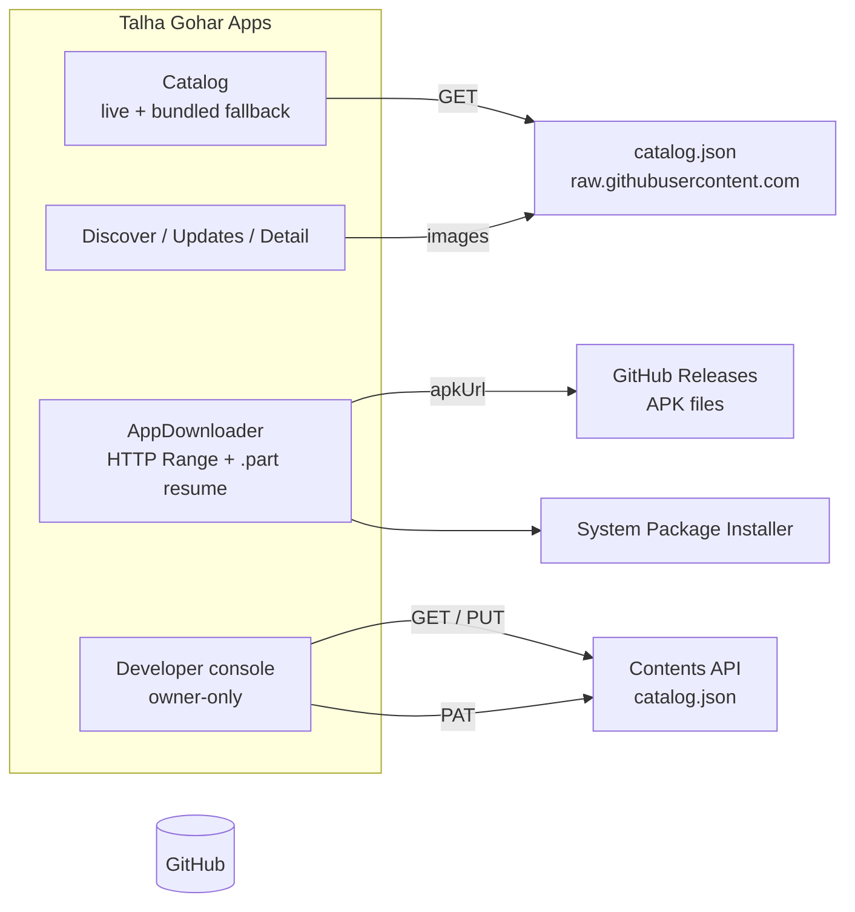

<div align="center">


# Talha Gohar Apps

**One store for all of Talha's Android apps — browse, download and update, like a small Play Store.**

[](https://github.com/TalhaGoharWeb/talha-gohar-apps)
[](https://developer.android.com/about/versions/oreo)
[](https://kotlinlang.org/)
[](https://m3.material.io/)
[](https://developer.android.com/about/versions/16)
[](#features)

**Latest release:** v1.4.3 (code 22) · Package `com.gohar.store` · Android 8.0+ · ~17 MB · Urdu name: **طلحہ گوہر ایپس**

</div>

---

## What this is

**Talha Gohar Apps** is a personal Android app store. No server, no accounts, no payments, no tracking, no ads — the entire store runs off one JSON file and GitHub Releases. It is free forever, and it works offline from a bundled catalogue when there is no connection.

## Apps in the store

| App | Version | Status |
|-----|---------|--------|
| Maliki Fiqh Hub | 2.0.0 | Coming soon — no public release APK yet |
| Nigaarish | 1.5.72 | Download |
| Talha Gohar Writings | 1.5.0 | Download |
| Kisan Dost | 1.0.15 | Download |
| Maliki Prayer Times | 1.3.9 | Download |
| Mera Roznamcha | 1.1.6 | Download |

**Design principles**

| Principle | What it means in practice |
|---|---|
| **Catalogue-driven** | Everything on screen comes from [`catalog.json`](catalog.json). No app is hard-coded into the UI. |
| **Zero backend** | GitHub is the server: `catalog.json` for data, Releases for APKs, the Contents API for publishing. |
| **Honest UI** | No fake ratings, download counts or placeholder screenshots. An app is either downloadable or marked *Coming soon*. |
| **Owner-only publishing** | The developer console appears only after the owner signs in. Everyone else gets a read-only store. |
| **Offline-first** | A bundled copy of the catalogue ships inside the APK; the live copy is fetched when online. |

---

## Features

- **Discover / Updates tabs** — browse every app, or only the apps with an update available, with an update badge when a newer `versionCode` appears in the catalogue.
- **Play Store-style app pages** — real icons, swipeable screenshot gallery with a full-screen viewer (pinch zoom, pan, thumbnail strip, ✕ to close), What's New, About, category and size.
- **Dark / Light / System theme** — switch in the navigation drawer; the choice is saved and applies on launch. Dark is the designed default look; light is a genuine light theme, not an inversion. Status bar stays navy with light icons in both themes.
- **Install / Update / Open** — APKs download straight from GitHub Releases, then the system installer takes over (Android asks once to allow installs from this store).
- **In-app self-update** — the store checks its own version in `store-version.json` on launch (and on "Check for updates"), and when a newer build is published it downloads the APK from R2, verifies its SHA-256, and offers the install — no link needed. Every update is optional; the APK lives on R2 (`talha-gohar-apps` bucket) and the version file in this repo's root.
- **Resumable downloads** — downloads are fetched with HTTP `Range` requests into `.part` files, so they can be **paused, resumed and cancelled** and survive an interrupted connection. Download state is persisted, so a resume works even after the app restarts.
- **Search, categories, pull-to-refresh** — filter by name or category; swipe down to re-fetch the live catalogue. First load shows skeleton placeholders instead of a bare spinner.
- **About the Author** — the author's own bio (Urdu verbatim, faithful English translation), with his Malikimadhab.org project and contact, from the drawer.
- **Responsive** — one column on phones, two-column grid on tablets (≥600dp), content capped at 720dp; section titles carry real catalogue counts, e.g. "All apps (6)".
- **Sticky install bar** — the app page keeps version + size and the Install / Open / Update button visible while scrolling.
- **Urdu + English** — a full Urdu version in the same APK (اردو / English switch in the drawer, or follows the phone language and Android 13 per-app language settings). Urdu text is set in **Jameel Noori Nastaleeq**, with per-locale dimensions so the tall Nastaliq script never clips. Every screen, dialog, toast and error message is translated — technical values (HTTP codes, URLs, package names, versions) stay in Latin script.
- **Featured hero** — the featured app gets a compact hero card that can be dismissed (drawer → *Show featured app* brings it back).
- **Developer console** — the owner manages the whole catalogue from inside the app: add, edit or remove apps, then publish. The change goes live for every user within seconds. See [PUBLISH-GUIDE.md](PUBLISH-GUIDE.md). Entry is hidden: **tap the version number in the drawer header 5 times** (opens sign-in when signed out, the console when signed in). The editor has a category dropdown (English/Urdu kept in step) and warns before discarding unsaved changes.
- **Forgot password?** — on the owner sign-in screen. If a Google account was linked at setup, picking it lets the owner set a new password without wiping anything; otherwise the only way is to erase the owner sign-in and set it up again (there is no emailed reset — the app has no server).

---

## Architecture



**Data flow**

1. On launch the app fetches `catalog.json` from `raw.githubusercontent.com/TalhaGoharWeb/talha-gohar-apps/main/catalog.json`. If the network fails, it falls back to the bundled copy in `assets/catalog.json`.
2. Icons and screenshots are loaded from the same repo (`icons/`, `screenshots/<app-id>/`) with a disk + memory cache and downsampling.
3. Tapping **Install / Update** downloads the APK from the app's `apkUrl` (a GitHub Release asset) with resumable HTTP Range requests, then hands the file to the system installer through a `FileProvider`.
4. The owner signs in (tap the version number in the drawer header 5 times), opens the **Developer console**, edits an app, and taps **Publish** — the app writes the updated `catalog.json` back to the repo through the GitHub Contents API. Every user's store picks the change up on its next refresh.

**Update detection** — the Updates tab compares the installed app's `versionCode` (from `PackageManager`) against the catalogue's `versionCode`. An update is offered only when the catalogue's code is higher.

---

## Tech stack

| Layer | Technology |
|---|---|
| Language | Kotlin |
| UI | Classic Views + Material 3 (`material:1.12.0`, `appcompat:1.7.1`, `core-ktx:1.19.1`) |
| Build | Android Gradle Plugin 9.1.0 · Gradle 9.3.1 · JDK 21 |
| SDK | `compileSdk 36` · `targetSdk 36` · `minSdk 26` (Android 8.0+) |
| Networking | `HttpURLConnection` — no networking libraries, no tracking SDKs |
| Downloads | Custom `AppDownloader`: HTTP `Range`, `.part` files, persisted state |
| Images | Custom `ImageLoader`: disk + memory cache, downsampling, no new dependencies |
| Urdu type | **Jameel Noori Nastaleeq** (freeware), bundled in `res/font/` |
| Signing | Release keystore `talha-gohar-apps.keystore` (owner-held, git-ignored) |
| Distribution | GitHub Releases · catalogue at `raw.githubusercontent.com` |

**No dependencies beyond AndroidX.** The app deliberately avoids third-party SDKs: no analytics, no ads, no crash reporting, no accounts.

---

## The catalogue — `catalog.json`

The store is data, not code. Every app is one JSON object; the store renders whatever the file contains.

```json
{
  "catalogVersion": 1,
  "storeName": "Talha Gohar Apps",
  "tagline": "All my apps, in one place.",
  "updated": "2026-11-27",
  "apps": [
    {
      "id": "maliki-fiqh-hub",
      "name": "Maliki Fiqh Hub",
      "nameUr": "مالکی فقہ ہب",
      "packageName": "com.hijaziapps.maliki_fiqh_user",
      "developer": "Talha Gohar",
      "category": "Education",
      "categoryUr": "تعلیم",
      "tagline": "Maliki fiqh, articles and quizzes.",
      "taglineUr": "مالکی فقہ، مضامین اور کوئز۔",
      "description": "Maliki Fiqh Hub brings the bilingual Maliki fiqh articles and quiz database together in one app …",
      "descriptionUr": "مالکی فقہ ہب میں دو لسانی مالکی فقہ مضامین اور کوئز ڈیٹا بیس یکجا ہیں …",
      "versionName": "1.0",
      "versionCode": 1,
      "minSdk": 21,
      "sizeBytes": 47091736,
      "apkUrl": "https://github.com/TalhaGoharWeb/releases/releases/download/v1.0.0/Maliki.Fiqh.Hub.apk",
      "iconUrl": "https://raw.githubusercontent.com/TalhaGoharWeb/talha-gohar-apps/main/icons/maliki-fiqh-hub.png",
      "iconColor": "#B45309",
      "iconColor2": "#D97706",
      "iconLetter": "M",
      "featured": true,
      "whatsNew": ["First public release"],
      "whatsNewUr": ["پہلی عوامی ریلیز"],
      "screenshots": ["https://raw.githubusercontent.com/TalhaGoharWeb/talha-gohar-apps/main/screenshots/maliki-fiqh-hub/01-home-urdu.jpg"]
    }
  ]
}
```

**Field rules**

| Field | Required | Notes |
|---|---|---|
| `id`, `name`, `packageName` | Yes | `id` is unique; `packageName` is the Android package |
| `versionName`, `versionCode` | Yes | **The `versionCode` must rise** or users see no update |
| `apkUrl` | For downloads | `null` + `comingSoon` text = *Coming soon* (no fake download button) |
| `sizeBytes` | Yes | Exact byte size of the APK; shown on the app page |
| `iconUrl` / `iconColor` + `iconColor2` / `iconLetter` | — | Real icon if `iconUrl` is set; otherwise a gradient tile with the letter |
| `nameUr`, `taglineUr`, `descriptionUr`, `categoryUr`, `whatsNewUr`, `comingSoonUr` | For Urdu | The Urdu UI renders these; English falls back when a field is absent |
| `featured` | — | Exactly one app should be featured; it gets the hero card |
| `screenshots` | — | Real screenshots only — never placeholders. Empty list hides the gallery |
| `minSdk` | — | Minimum Android API the app needs (informational) |

The two copies — repo-root `catalog.json` and `android/app/src/main/assets/catalog.json` — must stay **byte-identical**.

---

## Build from source

**Requirements:** JDK 21, Android SDK with API 36, Gradle 9.3.1, Android Gradle Plugin 9.1.0. There is no Gradle wrapper in this repo; invoke Gradle directly.

```bash
cd android
gradle assembleDebug      # debug APK, unsigned
gradle assembleRelease    # release APK — needs the owner's key (below)
```

**Release signing** — `android/key.properties` (git-ignored) points at the owner's keystore:

```properties
storeFile=talha-gohar-apps.keystore
storePassword=<owner only>
keyAlias=talhagoharapps
keyPassword=<owner only>
```

The keystore is **not** in this repo. A release build without it cannot be signed with the store key, and an APK signed with any other key will not install as an update over the published app — Android requires the same signing certificate for updates.

### Verify a release

Every release is verified before publishing — signature, alignment, content and the served file:

```bash
# Signature and the signing certificate
apksigner verify --verbose --print-certs app/build/outputs/apk/release/app-release.apk

# 16 KB alignment
zipalign -c -v 4 app/build/outputs/apk/release/app-release.apk

# The built file — compare against the distributed link's file
sha256sum app/build/outputs/apk/release/app-release.apk
```

**v1.4.3 reference values**

| Check | Value |
|---|---|
| Version | 1.4.3 (code 22), package `com.gohar.store` |
| Size | 17,257,791 bytes |
| SHA-256 | `0e5ad31176f8c909f7e1104bde7765cd9d56794dcd4d4341e5bdc60ebf36996b` |
| Signature | `apksigner verify` PASS, 1 signer, CN=Talha Gohar |
| Certificate SHA-256 | `C0:C6:C3:F2:C8:B1:6B:9D:B8:6C:4A:47:4C:4B:D8:57:11:52:1C:BA:A2:4F:CC:C5:98:5F:B4:0B:53:FE:9B:D8` |
| Alignment | `zipalign` verified |
| Dex | `MainActivity` and `SelfUpdate` present in `classes.dex` |

---

## Publishing an app

1. Upload the APK to a GitHub Release in that app's own repo.
2. Edit `catalog.json` — **the `versionCode` must rise** — or use the developer console inside the app (tap the version number in the drawer header 5 times, then *Developer console*), which validates the entry and writes the file for you.
3. Push. Users get the new version on their next refresh.

Full steps, including the console's token setup, are in [PUBLISH-GUIDE.md](PUBLISH-GUIDE.md). Build and verification notes live in [android/README.md](android/README.md).

---

## Project structure

```
.
├── catalog.json                  # The store itself — live catalogue (source of truth)
├── about-author-bio.md           # Source text of the About page (author's own bio, verbatim)
├── README.md                     # This file
├── PUBLISH-GUIDE.md              # Publishing flow, console token setup
├── brand/                        # Logo assets
│   ├── logo-icon.png             # Current launcher icon (full-bleed navy brand mark)
│   ├── logo-icon-v1.png          # Previous rounded-square mark
│   ├── logo-mark-cream.png       # Earlier cream avatar mark
│   ├── logo-mark-dark.png        # Earlier dark avatar mark
│   └── logo-board.jpg            # Full brand board
├── icons/                        # Per-app icons (real artwork, 512 px)
├── screenshots/<app-id>/         # Real Play Store-style screenshots, 10 per app
├── android/
│   ├── README.md                 # Build + release notes per version
│   ├── app/src/main/
│   │   ├── AndroidManifest.xml
│   │   ├── java/com/gohar/store/
│   │   │   ├── MainActivity.kt          # Tabs, search, chips, featured hero
│   │   │   ├── AboutActivity.kt         # About the Author page (author's own bio)
│   │   │   ├── DetailActivity.kt        # App page: gallery, About, downloads
│   │   │   ├── Catalog.kt               # Catalogue model + live/bundled loading
│   │   │   ├── GitHubCatalog.kt         # Contents API: read/write catalog.json
│   │   │   ├── AppDownloader.kt         # Resumable HTTP Range downloads
│   │   │   ├── ImageLoader.kt           # Disk + memory image cache
│   │   │   ├── AuthManager.kt / AuthActivity.kt   # Owner sign-in (device-local password)
│   │   │   ├── AdminActivity.kt / AdminEditActivity.kt  # Developer console
│   │   │   ├── ScreenshotViewerActivity.kt
│   │   │   └── StoreActions.kt          # Install / update / open intents
│   │   ├── res/
│   │   │   ├── font/jameel_noori_nastaleeq.ttf   # Urdu typeface (13.8 MB)
│   │   │   ├── values-ur/               # Urdu strings, theme + dimensions
│   │   │   ├── mipmap-*/                # Launcher icons (legacy + adaptive)
│   │   │   └── drawable-*/              # Toolbar avatar, chips, badges
│   │   └── assets/catalog.json          # Bundled offline catalogue (== root copy)
└── release/                      # Local release APKs (git-ignored)
```

---

## Security & privacy

- **Signing key** — release APKs are signed with the owner's keystore, which never leaves the owner's machine and is never committed. The certificate fingerprint above is the public check that an APK is a genuine update.
- **Owner gate** — the developer console is hidden unless the owner is signed in (device-local salted SHA-256 password). There is no visible entry point: the owner opens it by **tapping the version number in the drawer header 5 times**. The gate is enforced **on-device**; the GitHub personal access token is what actually authorises publishing, and it lives only in the app's private `SharedPreferences` (last 4 characters shown, clear-token option in the console). Forgotten password: if a Google account was linked at setup, the sign-in screen's *Forgot password?* lets the owner set a new password; otherwise the owner sign-in must be erased and set up again.
- **No data collection** — the app sends nothing anywhere except: fetching `catalog.json`, icons and screenshots from GitHub, and downloading APKs from GitHub Releases. No analytics, no ads, no accounts.
- **No server to attack** — there is no backend. The worst case for a compromised catalogue is a wrong listing, and the catalogue is versioned in git.

---

## Version history

| Version | Code | What changed |
|---|---|---|
| 1.0.0 | 1 | First store: Sett + Maliki Fiqh Hub downloadable; PRIVACY X + Nigaarish *Coming soon* |
| 1.1.0 | 2 | Renamed **Talha Gohar Apps**; app-store redesign; full Urdu version in the same APK |
| 1.2.0 | 3 | Correct Urdu name طلحہ گوہر ایپس; brand-board logo; screenshot gallery; developer console |
| 1.3.0 | 4 | Owner-only sign-in gating the developer console |
| 1.3.1 | 5 | Compact dismissible hero; pause / resume / cancel downloads; cream avatar logo |
| 1.3.2 | 6 | **Jameel Noori Nastaleeq** Urdu font; new dark brand icon + appbar avatar; toolbar title fix; taller buttons; repo renamed to `talha-gohar-apps` |
| 1.3.3 | 7 | **New full-bleed app icon** from the latest brand mark (adaptive foreground = central emblem, no text) |
| 1.3.4 | 8 | Splash screen, exit confirmation, uninstall button |
| 1.3.5 | 9 | Crash catcher + crash-report dialog; fixed the empty-APK build (forced AGP 8.11.1 skipped Kotlin) |
| 1.3.6 | 10 | Status-bar overlap fix; centred banner logo; full-lockup icon + splash |
| 1.3.7 | 11 | App-bar title back on one side (EN/UR), measured to fit at 360dp |
| 1.3.8 | 12 | UI polish + responsive (2-column grid ≥600dp); About the Author page; Talha Gohar Writings added (R2) |
| **1.3.9** | **13** | **Author's own bio on the About page; store-style home (search pill, counts, sticky install bar); Urdu font fix for category chips** |
| 1.3.10 | 14 | App-bar banner enlarged to 48dp |
| 1.3.11 | 15 | Hamburger side drawer replaces the ⋮ menu; developer console refresh (status card, icon actions) |
| 1.3.12 | 16 | Compact one-row app bar (hamburger + title + full banner); console card alignment fix |
| 1.3.13 | 17 | Full uncropped banner in one row; own 40dp hamburger button |
| 1.3.14 | 18 | Manifest `<queries>` fix — the 4 catalogue apps can show Open/Update on Android 11+ |
| **1.4.0** | **19** | **Full redesign (Material 3, dark + light themes, drawer theme switch, skeleton loaders, FAB console, viewer zoom/pan + thumbnails, editor category dropdown + unsaved-changes warning, custom toasts, full Urdu strings, hidden version-tap owner entry, forgot-password).** The earlier planned 1.4.0 scope (email rating/feedback + analytics) is deferred to a later version. |
| **1.4.1** | **20** | **In-app self-update: the store checks `store-version.json` on launch / "Check for updates", downloads its own APK from R2, verifies SHA-256, and installs from inside the app. All updates optional in this version (mandatory enforcement deferred).** |
| 1.4.2 | 21 | Drawer tagline is now **All apps** / «تمام ایپس» (was "Free apps by Muhammad Talha Bin Fareed" / «محمد طلحہ بن فرید کی مفت ایپس»). |
| 1.4.3 | 22 | Author bio: Maliki asaneed line added (education in Maliki fiqh from authoritative teachers, asanid obtained). |

---

## Brand

The logo is Talha's avatar mark — navy, teal and gold. The launcher icon is the **dark navy brand mark** [`brand/logo-icon.png`](brand/logo-icon.png) (avatar + rings + *Talha Gohar APPS*, full-bleed navy, no white corners at all); the adaptive icon uses the central emblem only (no text). The toolbar shows the plain avatar portrait (transparent background, from Talha's own image). Earlier marks are kept in `brand/` (`logo-icon-v1.png`, `logo-mark-cream.png`, `logo-mark-dark.png`); the full board is [`brand/logo-board.jpg`](brand/logo-board.jpg).

Urdu type: **Jameel Noori Nastaleeq** (freeware — free of charge for Urdu lovers; personal use).
