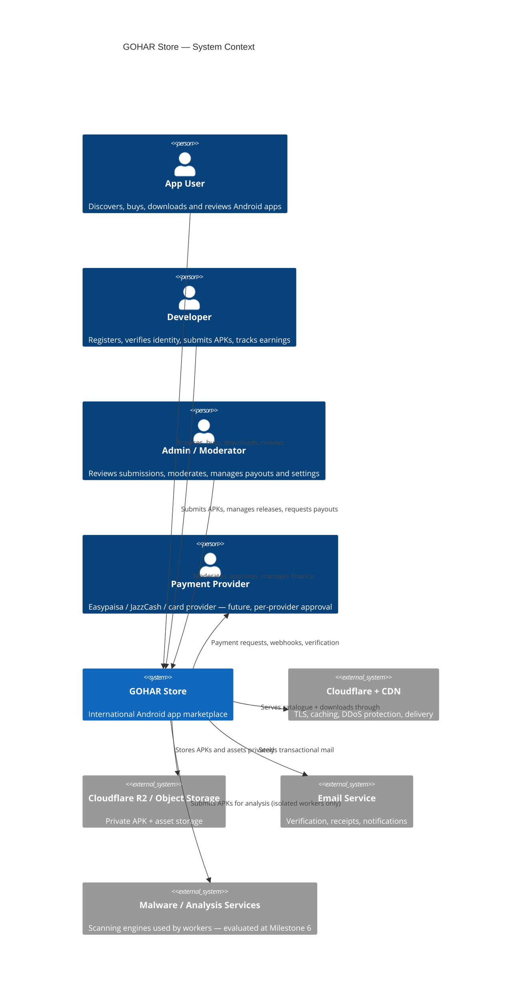
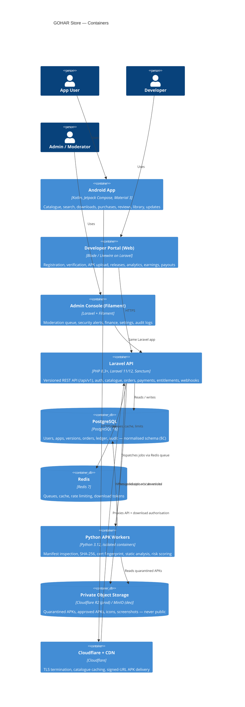
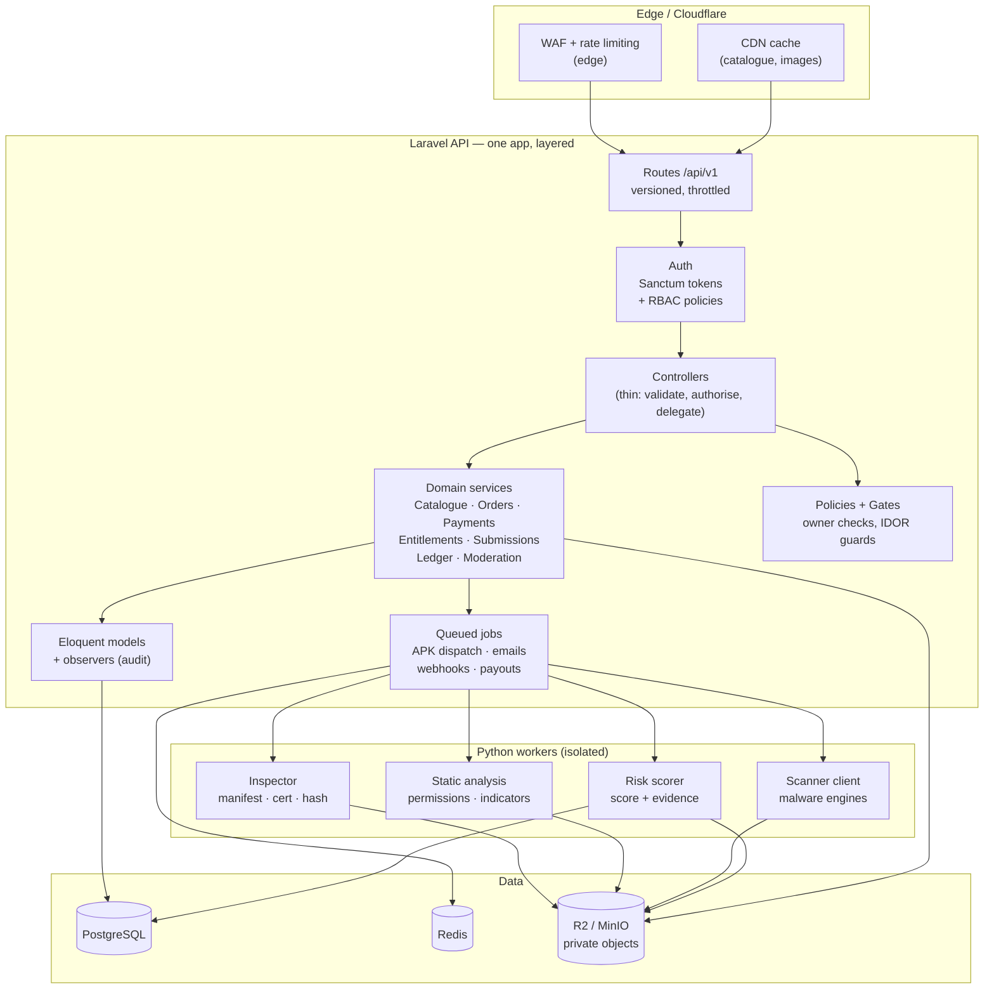
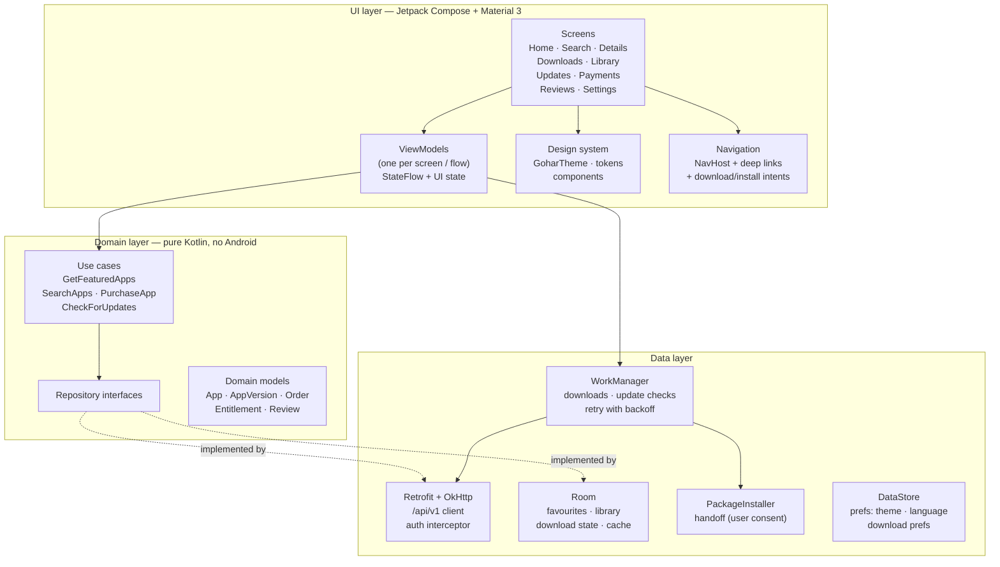
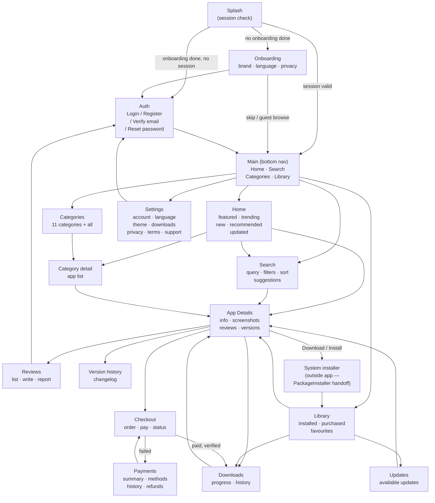

# GOHAR Store — Architecture v1

**Document:** `01-audit-architecture.md`
**Version:** 1.0 — 26 November 2026
**Status:** DRAFT FOR APPROVAL — no code has been built. Nothing in this document claims an implementation, test result, or deployed service exists.
**Scope of this file:** Sections A (Repository Audit), B (System Architecture), D (Android Screen Map), I (Infrastructure & Deployment Plan). Companion sections C (Database Diagram), E (API Specification), F (APK Security Pipeline), G (Payments & Ledger), H (Milestones), J (Risk Register) live in sibling files under `~/workspace/gohar-store/docs/` and are referenced, not duplicated, here.
**Audience:** Talha (product owner / decision-maker), and the engineering team that will implement Milestones 1–10 after approval.

**Brand anchors (fixed by the brief):** GOHAR Store — *"Where Great Apps Belong."* Premium, trustworthy, modern, international, developer-friendly. Deep navy + teal, Material 3, light and dark themes, English first, Urdu-ready. Commission: 15% proposed, configurable in admin settings, never hardcoded.

**Standing constraint carried into every decision below:** Talha's hard rule is **zero spend** — no paid APIs, stores, or infrastructure unless he explicitly approves a bigger swing. The brief asks for a VPS, Cloudflare, R2, and CDN, all of which cost money. That conflict is flagged explicitly in §A.5 and §I.7. Nothing in this document assumes paid infrastructure is approved.

---

## A. Repository Audit

### A.1 Verdict in one paragraph

**There is no existing GOHAR Store repository to audit.** No repository URL was supplied in the brief, no `gohar-store` folder existed in the workspace before today (26 November 2026), and a memory search found no prior GOHAR Store work, code, design, or decision. The only thing that exists is the empty directory created for this deliverable: `~/workspace/gohar-store/docs/`. This section therefore records exactly what was checked, what cannot be audited, what access is needed, and the recommended path forward: **create a clean project** using the architecture in §B, rather than regenerating or replacing anything.

### A.2 What was checked

| # | Check performed | Method | Result |
|---|---|---|---|
| 1 | Workspace listing for an existing project | `ls ~/workspace/` | No `gohar-store` folder before today. Neighbouring projects present (Sett, Private X, Nigaarish review, Meri Zameen, SHIRAZI, etc.) — none is a marketplace and none is reused here without a separate decision. |
| 2 | Memory search for prior GOHAR Store work | `muse.memory_search` over `~/MEMORY.md` and `~/memory/` | No hits. No prior brief, repo, design, or decision on record. |
| 3 | Brief itself for a repository reference | Read of the Master Development Brief in full | No GitHub URL, no repo name, no branch, no existing file or service named. The brief's §5 anticipates this case explicitly: *"If there is no existing marketplace repository, create a clean project using the architecture in this document."* |
| 4 | Toolchain available on this VM | `which php composer docker`; `ls ~/workspace/toolchain/jdk17/bin/java` | **No `php`, no `composer`, no `docker` on PATH.** Java 17 exists only under `~/workspace/toolchain/jdk17` (installed for the Sett/Private X Android builds). Consequence: a Laravel backend cannot be run or tested natively on this VM today; Docker is the reproducible route (§I.3). |
| 5 | F-Droid reference evaluation (brief §4) | Licence and architecture review, summarised here; full analysis belongs in §B.6 / §F | F-Droid overall AGPL-3.0, client GPL-3.0, fdroidserver AGPL-3.0. Historically re-signs apps with its own key and hosts only FOSS built from source. **Incompatible** with GOHAR's preserve-developer-signing + paid/proprietary model. Borrow concepts only (signed index, update checks); do not adopt fdroidserver as the marketplace. |

### A.3 Claimed vs Verified

| Claim / assumption in the brief | Verified? | Evidence / note |
|---|---|---|
| An existing repository or project was supplied | **No — not verified** | No URL in the brief; no folder in workspace; no memory record. |
| Framework, dependencies, and architecture of an existing codebase | **Cannot be audited — nothing exists** | No `build.gradle`, `composer.json`, `package.json`, migration, or schema to inspect. |
| Existing screens, APIs, database schemas, build config | **None exist** | Nothing to inspect. Any API or table named in companion docs (§C, §E) is a *design proposal*, not an existing artefact. |
| Reusable code from a prior project | **None identified** | Sett (GeckoView browser) and Private X (Flutter security suite) are different products on different stacks. Reuse is a Milestone 1 decision, not an audit finding — see §A.6. |
| Technical debt / security risks in existing code | **None — no code** | Debt and risk are assessed prospectively in §J (Risk Register), not as findings against a codebase. |
| F-Droid tooling can serve as the marketplace | **No — evaluated and rejected as a base** | Licence (AGPL-3.0) + re-signing + FOSS-only hosting conflict with the brief's §§9–10. Concepts only. |
| Laravel + PostgreSQL + Redis + Python workers is the stack | **Design decision, not a verified existing stack** | Adopted from the brief §4 as the architecture to build (§B). No server, database, or worker exists yet. |
| VPS / Cloudflare / R2 / CDN are available | **No — not verified, and in conflict with zero-spend** | No account, domain, or subscription is on record. See §A.5 and §I.7. |
| PHP/Composer/Docker toolchain is available on this VM | **No** | Verified absent on PATH (§A.2, row 4). Docker install (or a devcontainer) is a Milestone 2 prerequisite. |

### A.4 What cannot be audited

Because there is no codebase, the following audit questions have **no answer** and must not be filled in by invention:

- Framework and language versions in use (none).
- Dependency list and known-vulnerable dependencies (none).
- Existing screens and navigation (none — §D is a design, not an inventory).
- Existing API endpoints, request/response shapes, and auth flows (none — §E is a specification to build).
- Database schema, migrations, indexes, and data volume (none — §C is a design).
- Build configuration, signing keys, CI pipelines, deployment history (none).
- Test coverage and test results (none — no tests exist; no test result is claimed anywhere in this deliverable).
- Security posture of a running service (no running service).
- Technical debt, dead code, and performance bottlenecks (none).

Any future audit of a real repository must re-run this section against the actual tree and replace this "no repo" verdict with a file-by-file inventory.

### A.5 The zero-spend conflict — flagged, not resolved

The brief (§§4, 15, 19) specifies a Linux VPS, Docker, Cloudflare, Cloudflare R2 (or equivalent private object storage), a CDN, automated backups, monitoring, and CI/CD. Every one of those, at production quality, costs money — VPS rental, R2 storage/egress, a domain, and (for paid apps) payment-provider merchant onboarding. Talha's standing rule is zero spend.

This document does **not** assume the spend is approved. The architecture in §B and the deployment plan in §I are therefore written in two layers throughout:

1. **Zero-spend development layer (approved by default):** local Docker Compose on this VM or a developer machine, SQLite/PostgreSQL in containers, local object storage (MinIO as an S3-compatible stand-in for R2 — same API, no bill), free-tier CI (GitHub Actions free minutes), no domain, no production data.
2. **Paid production layer (needs an explicit decision):** VPS, domain, R2, Cloudflare, backups, monitoring, payment-provider merchant accounts. §I.7 lists each item with its cost class and the decision Talha must make before a single rupee/dollar is spent.

No milestone may incur a charge without that decision. Milestones 1–6 can be completed entirely on the zero-spend layer.

### A.6 Reusable code — honest assessment

| Candidate source | What it is | Reuse verdict |
|---|---|---|
| Sett browser (`~/workspace/private-x/android/`, Kotlin, GeckoView) | A privacy browser, v0.25.0, build-verified, **not device-accepted** | **Do not reuse as a base.** Different product, different engine (GeckoView), different purpose. Individual patterns (Material 3 theming, settings screens) may be consulted as reference during Milestone 2, with attribution to their own repo — not copied as a marketplace foundation. |
| Private X (`~/workspace/privacy-x/`, Flutter) | A Flutter security suite, v1.0.0 APK built and file-verified | **Do not reuse.** Wrong stack (Flutter vs the brief's Kotlin/Compose) and wrong product. |
| Meri Zameen / Crop Companion plans | Farm app + APK plan | **No code reuse.** The Advisor Engine's scoring pattern (weighted criteria) is a useful *design reference* for the APK risk-scoring design in §F, nothing more. |
| Nigaarish review / fix plan | Code review of a third-party Flutter diary app | **No reuse.** The review's lessons (silent data loss from non-atomic saves, unsigned OTA, device-clock trust) are cited as cautionary patterns in §J, not as code. |
| F-Droid client / fdroidserver | Open-source app store + repo tooling | **Concepts only** (§B.6). No code adoption without a separate licence-compatibility review at Milestone 1. |

**Net:** the clean project starts from empty repositories (Android + Laravel + Python workers), not from a fork.

### A.7 Exact access needed to continue

If an existing repository *does* exist somewhere and was simply not attached to the brief, the audit can be completed properly once the following are supplied. Until then, the clean-project path (§A.8) is the plan of record.

| # | Item needed | Why | Format |
|---|---|---|---|
| 1 | **GitHub repository URL** (or GitLab / other host) | To clone and inspect the actual tree | Full URL, e.g. `https://github.com/<owner>/<repo>` |
| 2 | **Read access** to that repository | Clone + inspect private repos | Collaborator invite, or a read-only deploy key / fine-grained PAT shared via the secure flow — **never a password in chat** |
| 3 | Default branch name if not `main` | To audit the right branch | Branch name |
| 4 | `README.md` and any architecture/decision notes | To understand intent vs implementation | Files in repo, or a link |
| 5 | `.env.example` (never a real `.env`) | To list required services/secrets without exposing values | File in repo |
| 6 | Confirmation of which parts (if any) are already live | To separate "built" from "planned" | One-line statement: nothing live / staging URL / production URL |
| 7 | Confirmation to **create a clean project** if no repo exists | The brief's own fallback (§5); needs Talha's explicit yes | One-word approval in the parent chat |

If items 1–2 are not supplied, items 3–6 are moot and the clean-project path stands.

### A.8 Decision: clean-project path

**Decision (recommended, pending Talha's approval in item 7 above):** create a clean project from scratch under a new repository (proposed name `gohar-store`, owner to be confirmed — Talha's existing GitHub org/user `TalhaGoharWeb` is the natural home, but the owner is Talha's call, not assumed).

Proposed repository layout (to be created at Milestone 2, not now):

```text
gohar-store/
├── android/                  # Kotlin + Jetpack Compose customer app
├── backend/                  # Laravel API + Filament admin + developer portal
├── workers/                  # Python APK inspection / scanning workers
├── infra/                    # Docker Compose, CI/CD, backup & deploy scripts
├── docs/                     # This deliverable (architecture, API spec, runbooks)
│   ├── 01-audit-architecture.md   # this file
│   ├── 02-database-diagram.md
│   ├── 03-api-specification.md
│   ├── 04-apk-security-pipeline.md
│   ├── 05-payments-ledger.md
│   ├── 06-milestones-roadmap.md
│   └── 07-risk-register.md
└── README.md                 # Project overview, quickstart, licence
```

**What is deliberately NOT done in this deliverable:** no code is generated, no repository is created, no service is provisioned, no dependency is installed. This is the architecture-first gate the brief (§20) requires: approve the design, then build in milestones.

### A.9 Open decisions / what needs Talha's approval (Section A)

1. **Confirm there is no existing repo** — or supply the URL + read access per §A.7. If a repo appears later, this audit must be re-run against it before Milestone 2.
2. **Approve the clean-project path** and the repository owner/name (`TalhaGoharWeb/gohar-store` proposed, not assumed).
3. **Acknowledge the zero-spend conflict** (§A.5): agree that Milestones 1–6 proceed on the zero-spend local layer, and that no production spend happens until §I.7 is decided.
4. **Approve or amend the "concepts only" F-Droid position** — no fdroidserver adoption, no re-signing, no FOSS-only restriction.

---

## B. System Architecture

### B.1 Design principles

1. **Trust is the product.** A marketplace that installs software on people's phones lives or dies on whether users and developers believe downloads are genuine, untampered, and attributable. Every architectural choice below is judged against that first.
2. **Never trust the client for money or safety.** Entitlements come only from server-verified payments (§G); safety verdicts come only from server-side workers (§F). The Android app is a display and download client, never an authority.
3. **Preserve the developer's signing identity.** GOHAR never re-signs a developer's APK (§B.7). The store's own signing key signs only repository metadata (the index), never APKs.
4. **Quarantine by default.** An uploaded APK is private and untrusted until every mandatory check passes and, where required, a human approves it. Unknown or ambiguous scan results are treated as *unsafe*, never as safe.
5. **Configurable commerce, not hardcoded commerce.** The 15% commission, supported currencies, and enabled payment providers are admin settings and database rows — never constants in code (§G).
6. **International-ready from day one, Pakistan-capable without Pakistan-specific core logic.** Currency, payment providers, and developer requirements are configuration; the core commerce engine knows no country (§B.8).
7. **Cheap to run, honest about scale.** The controlled launch is sized for tens-to-hundreds of apps and thousands of users, not an enterprise estate (§I.4). Scale is added by adding workers and read replicas, not by redesigning.

### B.2 C4 Context diagram



**Boundaries:** the user, developer, and admin are three roles on the same identity system (one `users` table, role-based access — §C), not three separate accounts. Payment providers, the CDN, object storage, email, and scanning services are all *external* — each behind an abstraction so any one can be replaced without touching core commerce or catalogue logic. No external service is trusted with an entitlement or safety decision; each is verified server-side.

### B.3 C4 Container diagram



**Container notes:**

| Container | Why it exists as a separate container | Failure mode if it dies |
|---|---|---|
| Android app | The only thing installed on user devices; must work offline for library/downloads and degrade gracefully when the API is down (§D states per screen). | Users cannot browse or buy; installed apps and completed downloads are unaffected. |
| Laravel API | Single source of truth for auth, catalogue, orders, entitlements, finance. All business rules live here, not in clients. | Everything server-side stops; CDN serves stale cached catalogue only. |
| Filament admin | Admin UI on the same Laravel app (same auth, same policies, same audit logging) — not a second backend. | Moderation/finance pause; public API unaffected. |
| Developer portal | Web UI for developers (upload, releases, analytics). Served by the same Laravel app; separated in the diagram because its users, flows, and file-upload needs differ from the API. | Developers cannot submit; public store unaffected. |
| Python APK workers | APK analysis must never run in the web process and never execute untrusted code on the production server (§F). Workers run in disposable, resource-limited containers with no network egress to the internet and read-only access to one quarantined object at a time. | Submissions queue up; nothing is auto-approved while workers are down (fail-closed). |
| PostgreSQL | Durable, transactional store. All money movement is in ACID transactions with immutable ledger rows (§G). | Total outage — the API cannot serve writes; read replicas (later) mitigate reads only. |
| Redis | Queues (submission processing, emails, webhooks), cache, rate limiting, short-lived download tokens. Ephemeral by design — everything in Redis can be rebuilt from PostgreSQL. | Queues stall; API degrades (no caching, no background jobs) but does not corrupt data. |
| R2 / MinIO | Private object storage. APKs are never served from a public bucket; every download is authorised and short-lived (§B.7). | Downloads stop; catalogue metadata still serves. |
| Cloudflare + CDN | TLS, WAF, DDoS protection, edge caching of catalogue/images, and delivery of large APKs without saturating the VPS. | Direct-to-origin fallback is possible but must be a deliberate, monitored break-glass step, never automatic. |

### B.4 Component view — Laravel API (the heart of the system)



**Layer rules (enforced by code review, not just convention):**

- **Controllers are thin.** They validate input, authorise the actor, and delegate to a service. No SQL, no money maths, no file handling in a controller.
- **Services own business rules.** One service per domain (e.g. `OrderService`, `EntitlementService`, `LedgerService`, `SubmissionService`). Money movement is always inside a database transaction; a service that touches money never calls another service that touches money without sharing the transaction.
- **Policies own authorisation.** Every route that touches a resource owned by someone (an app, an order, a payout) passes a policy check — this is the IDOR defence. A developer asking for another developer's app gets 403, never a filtered empty list that leaks existence.
- **Observers own audit.** `audit_logs` rows are written by model observers / explicit audit calls in services, never by controllers ad hoc — so a new endpoint cannot forget to log.
- **Jobs are retryable and idempotent.** Every queued job carries an idempotency key; a job that runs twice (Redis redelivery, worker restart) produces the same result once. This is mandatory for payment webhooks and ledger entries (§G).

### B.5 Component view — Android app (clean architecture)



**Why this shape, concretely:**

| Decision | Reason | What it forbids |
|---|---|---|
| MVVM + clean layers (UI / domain / data) | The brief requires MVVM or a justified clean architecture; this is the standard that keeps a marketplace testable as screens multiply. Domain code has no Android imports, so use cases are unit-testable on the JVM. | No Retrofit calls from a Composable; no Room access from a ViewModel directly; no business logic in UI code. |
| Retrofit + OkHttp | Mature, interceptors for auth token refresh and idempotency keys, streaming `ResponseBody` for large APK downloads (never load a whole APK into memory). | No `HttpURLConnection` one-offs; no downloading an APK via a JSON-parsed byte array. |
| Room for local persistence | Favourites, library, download state, and a catalogue cache must survive process death and offline use. | No SharedPreferences for structured data; no in-memory-only download state (a killed download must resume, not vanish). |
| WorkManager for downloads + update checks | Downloads must survive app kill, doze, and network loss; update checks must run periodically without a foreground service. WorkManager gives constrained, retryable, backoff-aware work for free. | No foreground-service download loop; no `AlarmManager` polling. |
| PackageInstaller handoff, never silent install | Android does not permit silent install on ordinary (non-system, non-device-owner) devices, and attempting it would be a security and Play-policy red line. The app hands a verified APK to the system installer and the user consents (§D, Downloads/Updates). | No reflection hacks, no root assumptions, no "install without asking". |
| DataStore (not SharedPreferences) | Async, type-safe preferences for theme, language, download prefs. | No blocking disk reads on the main thread. |

### B.6 Why Laravel + PostgreSQL + Redis

| Choice | Why for GOHAR | Alternatives considered and why not chosen now |
|---|---|---|
| **Laravel (PHP 8.3+, v11/12)** | The brief mandates it. Independently: Filament gives the admin console (§12) without building a second app; Sanctum gives token auth for the Android app and cookie auth for the web portal from one system; queues, migrations, policies, and testing tooling are built in; the hiring/contractor pool for Laravel is large in Pakistan and internationally. | Node/NestJS or Django would also work, but would discard the Filament admin advantage and contradict the brief. No framework change without Talha's approval. |
| **PostgreSQL 16** | The brief mandates it. Independently: strict types, real foreign keys, partial/exclusion constraints for money invariants, JSONB for flexible metadata (e.g. scan evidence) without abandoning a normalised core, and `FOR UPDATE` row locking for payout/ledger races. | MySQL is adequate but weaker on constraints and JSONB; SQLite is for local dev/tests only, never production. |
| **Redis 7** | Queues (submission processing, emails, webhooks), cache, rate limiting, and short-lived download tokens in one service. Everything in Redis is rebuildable from PostgreSQL. | Database-backed queues would couple background work to the primary database and make retry/backoff harder; a separate message broker (RabbitMQ/SQS) adds a service for no launch-scale benefit. Revisit if queue volume justifies it. |
| **Python workers (3.12)** | APK inspection has its best tooling in Python (`androguard` and equivalents — to be evaluated at Milestone 6, not assumed). Python workers also isolate untrusted-code analysis from the PHP process: a malicious APK can crash a worker container, never the API. | Doing APK parsing inside Laravel (PHP) would put untrusted-file parsing in the web process and lack the analysis ecosystem. Doing it in Kotlin on the server would duplicate tooling for no benefit. |

### B.7 Why Python workers are isolated (and what "isolated" means)

The brief (§8) is explicit: *never execute untrusted APKs directly on the production server*. The architecture enforces that with four layers:

1. **No execution at all in the happy path.** Workers *inspect* (unzip, parse `AndroidManifest.xml`, read certificates, hash bytes) — they do not run the APK's code. Dynamic analysis, if ever added, runs only in a disposable emulator/sandbox with no network route to production, and is a Milestone 6+ decision, not a launch requirement.
2. **Disposable containers.** Each analysis job runs in a fresh container (or a fresh sandbox directory with a new UID) that is destroyed afterwards. A compromised worker cannot persist.
3. **Least privilege.** Workers have read-only access to exactly one quarantined object (presigned, time-limited), write-only access to the results table, and no credentials for anything else. No shell access, no database superuser, no outbound internet except to the named scanning service(s) — and even that is proxied and logged.
4. **Resource limits.** CPU, memory, disk, and wall-clock limits per job (e.g. kill after N minutes, cap at M MB). A crafted APK that tries to decompress to gigabytes (zip bomb) dies with the container, not with the server.

**Fail-closed rule:** if a worker crashes, times out, or returns an ambiguous result, the submission stays in *manual review* — it is never auto-approved. "Unknown" is not "safe" (§F).

### B.8 Why Sanctum, and why repository metadata signing is separate from APK signing

**Sanctum:** the Android app needs long-lived API tokens (one per device/session, revocable per session — the `user_sessions` table in §C), while the developer portal and Filament admin need cookie-based web auth with CSRF protection. Sanctum provides both from one Laravel app, with token abilities (scopes) so an Android token can be limited to catalogue/purchase actions and can never call an admin endpoint. Alternatives (Passport/OAuth2, JWT-only) add complexity the launch does not need; Sanctum's revocation and per-device sessions map directly onto the required `user_sessions` table.

**Two signing keys, two jobs — never confused:**

| Key | Signs | Held by | If compromised |
|---|---|---|---|
| **Developer's APK signing key** | The APK itself (v1/v2/v3 APK Signature Scheme). Recorded as a certificate fingerprint per release; compared across releases (§F, §G). | The developer, always. GOHAR never holds it, never re-signs with a shared key. | Developer rotates per Android's key-rotation rules; GOHAR flags the change and requires explicit confirmation + re-verification before the new key is trusted. |
| **GOHAR repository key** | The repository *metadata* (the signed index listing apps, versions, hashes, and download URLs) — the F-Droid-style signed-index concept, adapted. | GOHAR, offline/HSM-backed in production; strict access controls, secure backups, documented rotation/recovery (§I.6). | The index can be re-signed with a rotated key after revocation; already-downloaded APKs are unaffected because their own developer signatures still verify. Clients pin/verify the repository key and reject an index signed by an unknown key. |

Conflating the two — e.g. re-signing APKs with a GOHAR key, as F-Droid historically does — would break Android's update identity (the system installer refuses an update whose signing certificate differs from the installed app's), destroy the developer's ownership of their signing identity, and make GOHAR liable for the contents of a binary it modified. The brief (§9) forbids it; this architecture forbids it structurally, not just by policy.

**Download integrity chain (each link independently verifiable):** developer signs APK → worker records SHA-256 + certificate fingerprint → approved release is stored immutably in R2 → download URL is short-lived and authorised per user/entitlement → Android app verifies SHA-256 after download and before handoff → system installer verifies the APK signature and (for updates) certificate continuity. A failure at any link aborts the install with a clear error, never a silent proceed.

### B.9 Design system — tokens (not per-screen styling)

A reusable design system is built once at Milestone 2 and consumed by every screen. No screen invents its own colours, type scale, or spacing.

**Colour tokens (light / dark):**

| Token | Light | Dark | Usage |
|---|---|---|---|
| `primary / navy` | `#0B2545` (deep navy) | `#8FB8E8` (lightened navy for contrast on dark) | Brand surfaces, primary buttons, app bar |
| `primaryContainer` | `#DCE8F7` | `#1B3A5C` | Highlighted cards, selected states |
| `secondary / teal` | `#0E7C7B` (teal) | `#4DB6B0` | Accents, prices, progress, links |
| `tertiary` (warm neutral) | `#C9A86A` (muted brass — sparing) | `#D9BC7A` | Featured badges, premium markers only; never for body text |
| `surface` | `#FAF8F4` (warm neutral) | `#121417` | Screen background |
| `surfaceContainer` | `#FFFFFF` / `#F1EDE6` | `#1E2126` | Cards, sheets |
| `onSurface` | `#1A1D21` | `#E8E6E1` | Primary text |
| `onSurfaceVariant` | `#5A6068` | `#A8ADB5` | Secondary text |
| `error` | `#B3261E` | `#F2B8B5` | Errors, takedowns, destructive actions |
| `success` | `#1B6B3A` | `#7BC98F` | Verified badges, completed downloads |

Contrast targets: body text ≥ 4.5:1, large text/UI ≥ 3:1 (WCAG AA), verified in both themes at Milestone 2 with a permanent contrast test so a later token change cannot silently regress readability — the same guard pattern used on the Sett redesign (light-theme contrast defect 2.84:1 → 4.52:1).

**Typography (Material 3 type scale, one family):** Display/Headline for hero and app names; Title for section headers; Body for descriptions and reviews; Label for buttons and chips. One font family with tabular numerals for prices. No per-screen font choices. Urdu text (when added) uses a Nastaliq-compatible font stack selected at that time — the type scale does not change, only the font family per locale.

**Spacing & shape:** 4dp base grid; 8/12/16/24dp spacing scale; 12dp card radius, 16dp sheet radius, full-radius chips; 48dp minimum touch target. Motion is restrained: 150–250ms fades/slides, no bouncy or parallax effects on transactional screens (purchase, download, install).

**Components (built once, reused everywhere):** `AppCard`, `RatingStars`, `PriceLabel`, `DownloadButton` (with progress/pause/resume states), `VerificationBadge`, `PermissionRow`, `ReviewCard`, `EmptyState`, `ErrorState` (with retry), `LoadingSkeleton`. A screen that needs a new component adds it to the design system with a token-based variant — it does not inline a one-off style.

### B.10 Internationalisation (i18n) approach

- **English first, Urdu-ready.** All user-visible strings live in Android string resources (`res/values/strings.xml`) and Laravel language files — never hardcoded in code or layouts. Urdu (`values-ur/`) is added by translating resources, not by redesigning screens.
- **RTL-ready.** Layouts use `start`/`end` (never `left`/`right`), Compose `Arrangement` respects layout direction, and the app is tested with forced RTL at Milestone 2 — before any Urdu string exists — so RTL bugs are caught while they are cheap.
- **Localised app descriptions.** The `apps`/`app_translations` design (§C) stores per-language title/description/changelog, so a developer can supply an Urdu description without a new release.
- **Currency as configuration.** Prices are stored as integer minor units + ISO currency code; display formatting uses the device locale. The default catalogue currency is a system setting, not a constant. No Pakistan-specific payment logic lives in core commerce — Easypaisa/JazzCash are *provider plugins* behind the payment abstraction (§G), enabled only after merchant approval.
- **Time zones.** All timestamps are UTC in the database and API; the app and portal render in the user's/device's time zone. Release dates, payout dates, and audit times are never stored in a local zone.
- **Regional rules as data.** Country-specific developer requirements (identity documents, tax info) and consumer rules (refund windows) are configuration rows per country, not `if (country == "PK")` branches in core code.

### B.11 Open decisions / what needs Talha's approval (Section B)

1. **Laravel version pin:** Laravel 11 vs 12 at Milestone 2 (whichever is current/stable then). No functional difference for this architecture; the choice is recorded at build time.
2. **APK analysis tooling:** `androguard` (or equivalent) is *evaluated* at Milestone 6, not adopted now. If evaluation finds a better tool, the worker interface does not change — only the implementation inside the worker.
3. **Malware scanning provider(s):** no provider is named or assumed in this document. Selection (including any free-tier limits and what "unknown result" means) is a Milestone 6 decision with its own cost/privacy review. No scan result is ever presented as a guarantee of safety.
4. **Repository key custody:** offline/HSM-backed custody is specified for production (§I.6), but the exact custody (offline machine vs managed HSM vs cloud KMS) is a pre-launch decision with a cost implication — see §I.7.
5. **Design-system font choice:** the font family is not named here (licence + Urdu-readiness to be confirmed at Milestone 2). The token structure above does not depend on it.
6. **Cloudflare plan:** free tier is assumed for development; any paid Cloudflare plan is a §I.7 spend decision.

---

## D. Android Screen Map

### D.1 Navigation graph



**Navigation rules:**

- **Guest browsing is allowed; buying, reviewing, and downloading paid apps are not.** A guest can browse the catalogue, search, and view app details. Any action that needs identity (purchase, review, favourite sync, download of a paid app) routes to Auth first and returns to the original screen afterwards (deep-link-preserving).
- **Bottom navigation** (Home, Search, Categories, Library) is the primary navigation; Downloads, Updates, Payments, and Settings are reached from Library / the top bar / App Details — not as bottom tabs — to keep the bar to four items.
- **Downloads and Updates are separate destinations** (the brief lists them separately): Downloads is active transfers + history; Updates is available-update detection + changelogs. They share the download engine (WorkManager) but not the screen.
- **The system installer is outside the app.** The graph shows it as a terminal node: the app hands over a verified APK and returns to Library/Downloads on completion. The app never pretends the install happened until the system reports it (§D.2, Downloads/Updates rows).

### D.2 Per-screen table

Endpoint names use only the `/api/v1/...` pattern from the API specification (§E); no other URLs are invented here. "Data source" names the endpoint family, not a final URL — the exact contract is §E's to define.

| Screen | Purpose & key states | Data source (API family) | Offline / empty / error states |
|---|---|---|---|
| **Onboarding** | Brand introduction ("Where Great Apps Belong"), language selection (English now; Urdu listed as *coming* — not selectable until translated), privacy summary, marketplace explanation (what GOHAR verifies, what it does not guarantee). One-time; skippable to guest browsing. | None (local) + `GET /api/v1/system/settings` for the public privacy/terms text version | Fully offline-capable; if settings fetch fails, shows the bundled copy with a "last updated" date, never a blank screen. |
| **Auth — Login / Register / Verify email / Reset password** | Email + password; registration collects name, email, password, country (for future regional rules); email verification link/code; reset via emailed link. Developer registration is a *separate* flow in the web portal, not in the app — the app offers a link out ("Become a developer"). | `POST /api/v1/auth/register`, `POST /api/v1/auth/login`, `POST /api/v1/auth/verify-email`, `POST /api/v1/auth/forgot-password` | Validation errors inline per field; wrong credentials → generic message (no account-enumeration); network failure → retry with the form preserved; verification deep link handled even if the app was killed. |
| **Home** | Featured apps (admin-curated carousel), Trending, New releases, Recommended (on-device recents + server signals; no tracking-based recommendation at launch), Popular categories (chips), Recently updated. Pull-to-refresh. | `GET /api/v1/apps/featured`, `GET /api/v1/apps/trending`, `GET /api/v1/apps?sort=newest`, `GET /api/v1/apps?sort=updated`, `GET /api/v1/categories` | Skeleton loading; empty catalogue → illustrated empty state ("No apps yet — check back soon") — honest, not faked content; API failure → error state with retry, cached content shown underneath if available. |
| **Search** | Query by app name *and* developer name; category filter chips; free/paid filter; sort by relevance / rating / popularity; suggestions as the user types (from popular queries + matching app/developer names); recent searches stored on-device (clearable). | `GET /api/v1/apps/search?q=…&category=…&price=…&sort=…`, `GET /api/v1/search/suggestions?q=…` | Empty query → popular searches + recent searches; no results → empty state with "clear filters" action; suggestion fetch debounced (300ms) and cancellable; offline → searches the Room cache only and labels results "offline results". |
| **Categories** | Extensible grid of the 11 launch categories — Productivity, Education, Business, Utilities, Finance, Communication, Photography, Entertainment, Games, Security, Development tools — plus "All apps". Category list is server-driven so a new category needs no app update. | `GET /api/v1/categories` (with app counts) | Offline → cached category list; a category with zero apps shows an empty state, never a fake listing. |
| **Category detail** | App list for one category, same filters/sort as Search, paginated. | `GET /api/v1/apps?category={slug}&sort=…&page=…` | Same empty/error handling as Search; pagination failure → "load more" retry without losing loaded items. |
| **App Details** | Icon, name, developer identity + verification badge, description, screenshots (swipeable gallery), category, current version, APK size, release date, minimum Android version, requested permissions (with plain-language explanations), privacy policy link, support contact, security assessment status (e.g. "Scanned — no known issues found" with date; never "guaranteed safe"), ratings summary + reviews preview, version history + changelog, price, Download / Buy action. | `GET /api/v1/apps/{slug}`, `GET /api/v1/apps/{slug}/versions`, `GET /api/v1/apps/{slug}/reviews` | Partial failure (e.g. reviews fail but details load) → the failed section shows its own retry, not a full-screen error; screenshots load progressively with placeholders; offline → cached details with a "last updated" stamp and disabled purchase. |
| **Downloads** | Active downloads with progress, pause / resume (where the server supports range requests), retry, cancel; download history; per-download integrity status (SHA-256 verified / failed). | `GET /api/v1/downloads` (history), download itself via authorised short-lived URL (see §B.8), `POST /api/v1/downloads/{id}/verify` (server-side record) | Network interruption → auto-pause with resume, not restart-from-zero (range requests); integrity failure → download discarded, error shown, re-download offered, and the event logged; storage-full → clear pre-download check with a helpful message before starting. |
| **Library** | Three tabs: Installed (detected via `PackageManager` where permitted — apps installed from GOHAR, matched by package name), Purchased (server entitlements), Favourites (synced when signed in, on-device when guest). | `GET /api/v1/me/entitlements`, `GET /api/v1/me/favourites`; installed detection is on-device | Guest → favourites are local-only with a "sign in to sync" hint; no purchased apps → empty state linking to Home; an installed app whose store record was removed shows "no longer listed" rather than disappearing silently. |
| **Updates** | Detects newer releases for installed GOHAR apps (version-code comparison against the server); shows version difference, changelog, size; update action downloads the new APK and hands it to the installer. **Before handoff: package name and signing-certificate fingerprint are compared with the installed app; a mismatch blocks the update and raises a security alert.** | `POST /api/v1/apps/check-updates` (package name + version code list), `GET /api/v1/apps/{slug}/versions` | No updates → "You're up to date" empty state with last-checked time; certificate mismatch → hard block with explanation + support link, never a bypass button; offline → last-known update state with a stale stamp. |
| **Payments — Checkout** | Purchase summary (app, price, commission note — the *store's* commission is not charged to the buyer; the summary shows what the buyer pays, not internal splits), supported payment methods (provider list is server-driven; a provider appears only after credentials + merchant approval + payment testing), payment status (pending / processing / completed / failed). | `POST /api/v1/orders`, `POST /api/v1/orders/{id}/pay`, `GET /api/v1/orders/{id}` | Payment is never confirmed from a client-side success message — the app polls/confirms server-side status and only then grants access (§G). Provider webview/redirect failure → order stays pending with a resume option; duplicate-tap protection via idempotency key. |
| **Payments — History & refunds** | Transaction history, per-order status, refund information and refund requests (where the refund policy allows), purchased entitlements. | `GET /api/v1/me/orders`, `GET /api/v1/me/payments`, `POST /api/v1/orders/{id}/refund-request` | Empty history → empty state; a refund request shows its status (requested / approved / rejected / processed) with the policy text beside it. |
| **Reviews** | Ratings summary (average, distribution), written reviews list, write-a-review (purchased users only for "verified purchase" badge; others may review but are not badged), developer responses inline, report-a-review. | `GET /api/v1/apps/{slug}/reviews`, `POST /api/v1/apps/{slug}/reviews`, `POST /api/v1/reviews/{id}/report`, `POST /api/v1/reviews/{id}/respond` (developer, portal/API) | Unpurchased user attempting a verified review → explained, not silently allowed; reported reviews show "under review" while moderated; empty reviews → "Be the first to review" (only for released apps, never for unlisted ones). |
| **Version history** (within App Details) | All releases with version name/code, release date, size, changelog, and security-assessment status per version. Only approved releases appear. | `GET /api/v1/apps/{slug}/versions` | An app with one version shows one row; a version removed/taken down shows its status, not a gap. |
| **Settings** | Account (profile, sessions, sign out, delete account), Language (English; Urdu listed as coming), Theme (System / Light / Dark), Notifications (new releases, updates, order status — per-channel toggles), Download preferences (Wi-Fi only, storage location where permitted), Privacy (data summary, permissions granted to the app), Terms / Privacy policy / Refund policy / Developer agreement links, Support (contact, FAQ). | `GET /api/v1/me`, `PATCH /api/v1/me`, `GET /api/v1/me/sessions`, `GET /api/v1/system/policies` | Settings are local-first (theme/language apply instantly, sync to server when signed in); policy pages are cached for offline reading with a version date. |

### D.3 Cross-screen behaviours (not owned by any one screen)

- **Loading:** skeletons for lists, spinners only for single actions (login, purchase). No screen shows a bare spinner for more than a few seconds without a progress explanation.
- **Errors:** every error state names what happened in plain language, what the user can do (retry / check connection / contact support), and never exposes a stack trace or raw API message.
- **Accessibility:** all screens meet the §B.9 contrast targets; touch targets ≥ 48dp; content descriptions on every icon button; TalkBack traversal order verified at Milestone 3; font scaling respected (no fixed-height text clipping).
- **Deep links:** `gohar.store/app/{slug}`, `gohar.store/category/{slug}`, verification and password-reset links all route through the graph in §D.1, including from a killed app state.

### D.4 Open decisions / what needs Talha's approval (Section D)

1. **Guest download of free apps:** the table assumes guests may browse but paid actions need sign-in; whether a guest may download a *free* app without an account is a product decision (account-gating grows the user base; open download grows distribution). Recommend: allow guest free downloads, require sign-in for purchases, reviews, and favourites sync — confirm or amend.
2. **Recommended-apps basis at launch:** no behavioural tracking exists at launch. "Recommended" is defined here as on-device recents + server-side popularity signals. Confirm no cross-user tracking is wanted before any richer recommendation is designed.
3. **Download storage location:** Android scoped-storage rules limit the choice; the exact user-facing option (app-private vs shared Downloads folder) is a Milestone 3 implementation detail — the screen promises a preference, not a specific path.
4. **Payment methods shown at launch:** none are live at launch (see §G). The Checkout screen is built provider-driven so methods appear only when a provider is actually enabled — confirm no provider is promised to users before its merchant approval lands.

---

## I. Infrastructure & Deployment Plan

### I.1 Environments

| Environment | Purpose | Data | Access |
|---|---|---|---|
| **Local dev** | Day-to-day development on a developer machine / this VM | Seed data only, generated by seeders; no real user data, no real APKs from developers | Developers only |
| **Staging** | Pre-release verification: the full stack (API, workers, portal, admin) running as it will in production, against staging services | Seed data + a small set of test APKs; payment providers in sandbox/test mode only | Team + Talha (review link) |
| **Production** | Controlled launch (§I.8) | Real users, developers, APKs, money | Public (storefront/API) + restricted admin; no direct database or server access except via the deploy pipeline |

**Rules:** staging mirrors production's topology (same containers, same queue, same storage abstraction) so a staging pass means something; production is never used for testing; no production secret ever appears in dev or staging; database migrations run forward only (no destructive migration on production without a backup and a rollback plan).

### I.2 Docker Compose services (dev + staging; production per §I.4)

One `docker-compose.yml` defines the whole stack so a new machine reaches a running system with two commands. Production uses the same images with production configuration — never a different build.

```yaml
# Simplified — full file is a Milestone 2 deliverable, not written here.
services:
  api:        # Laravel (PHP 8.3 + FrankenPHP/RoadRunner or php-fpm + nginx — decided at Milestone 2)
  queue:      # Laravel queue worker (same image as api, different command)
  scheduler:  # Laravel scheduler (same image, cron entrypoint)
  worker:     # Python APK worker (isolated, resource-limited — §B.7)
  postgres:   # PostgreSQL 16
  redis:      # Redis 7
  storage:    # MinIO (S3-compatible, dev stand-in for R2; same SDK calls)
  mailpit:    # Local mail catcher (dev only — never in staging/prod)
```

**Why Docker is the answer to the missing toolchain (§A.2):** this VM has no PHP, Composer, or Docker on PATH today. Docker (installed once on the dev machine / VPS) provides the PHP runtime, extensions, Node (for asset builds), and Python workers as versioned images — so "it works on my machine" becomes "it works in this image, everywhere". If Docker cannot be installed on this VM, the fallback is a devcontainer or a small dedicated dev VPS — a Milestone 2 setup decision, not a reason to install PHP natively and drift.

### I.3 What runs where (controlled launch)

| Service | Dev | Staging | Production (controlled launch) |
|---|---|---|---|
| Laravel API + portal + Filament | Docker container | Docker container | Docker container(s) on the VPS, behind Cloudflare |
| PostgreSQL | Docker container | Docker container | Docker container on the VPS with a mounted volume + PITR backups (§I.5); managed Postgres is a later scale decision, not a launch requirement |
| Redis | Docker container | Docker container | Docker container on the VPS (AOF persistence on) |
| Python workers | Docker container, 1 replica | Docker container, 1–2 replicas | Docker containers, 2 replicas, resource-capped |
| Object storage | MinIO (local) | MinIO or R2 test bucket | **R2 (private buckets)** — quarantine bucket and public-assets bucket are separate, both private-by-default |
| CDN / TLS / WAF | None (localhost) | Cloudflare (test zone or bypass) | **Cloudflare** — DNS, TLS, WAF, caching, rate limiting at the edge |
| Mail | Mailpit | Sandbox provider | Transactional provider (to be selected at Milestone 4; free-tier evaluated first) |
| CI | GitHub Actions | GitHub Actions | GitHub Actions (build/test; deploy only on green + manual approval for production) |

### I.4 VPS sizing — controlled launch, not enterprise scale

The brief asks for a VPS without sizing it. For a controlled launch (tens-to-hundreds of apps, thousands of users, APKs typically 5–100MB), the honest sizing is modest, with explicit headroom triggers:

| Resource | Controlled-launch size | Headroom trigger to scale |
|---|---|---|
| VPS | 4 vCPU / 8GB RAM / 100GB SSD (NVMe) | Sustained CPU > 70% or memory pressure over a week → 8 vCPU / 16GB |
| PostgreSQL | Same host, dedicated volume, connection pooling (PgBouncer or Laravel Octane pooling — decided at Milestone 4) | Active connections routinely > 80% of pool → read replica or managed Postgres |
| Redis | Same host, 1GB maxmemory, AOF | Evictions or queue depth routinely > 1,000 → dedicated Redis |
| Workers | 2 replicas, 1 vCPU / 1GB each, 10-minute job timeout | Queue wait routinely > 15 minutes → add replicas |
| Object storage | R2 (pay-per-GB stored; egress via Cloudflare — confirm current pricing at purchase time) | Storage growth is linear with APKs; no architectural change needed |
| Backups | Daily full + WAL archiving (PITR) to a second location | Retention increase only |

No Kubernetes, no multi-region, no auto-scaling group at launch — each would add cost and operational burden the launch volume does not justify. The architecture (§B) is what scales later (add API replicas behind a load balancer; add workers; add a read replica), not a launch-day platform.

### I.5 Backups

| What | How | Frequency | Retention | Restore test |
|---|---|---|---|---|
| PostgreSQL | `pg_basebackup` + WAL archiving (PITR) to object storage in a second location | Continuous WAL; daily base backup | 30 days of PITR, 90 days of weekly fulls | **Monthly restore drill** to a scratch container; a backup that has never been restored is assumed broken |
| R2 objects | R2 versioning on (accidental delete/overwrite recoverable); bucket replication or periodic sync to a second bucket/region if the plan supports it | Continuous (versioning) | Version history 30 days | Quarterly object-restore check |
| Repository signing key | Offline backup (encrypted, split custody — §I.6) | On creation + on rotation | Permanent, versioned | Annual recovery drill |
| Configuration / secrets | Secrets manager (not in the repo); configuration versioned in git (without values) | On change | Git history | Part of the staging rebuild test |
| Application code | Git (GitHub) + tagged releases | Every merge | Permanent | Every deploy is a fresh checkout of a tag |

**What is never backed up to the same place as the original:** a backup on the same VPS disk as the database protects against accidental deletion, not against host loss. The off-host copy is mandatory for production.

### I.6 Secrets management

- **No secret in the repository.** No `.env` file, no API key, no signing key, no password is ever committed. `.env.example` lists *names* only. CI fails on a secret-scan hit (gitleaks or equivalent in the pipeline).
- **No secret in the APK.** The Android app ships no API secret, no signing key, no payment credential. It holds only a public API base URL and its own Sanctum token (per session, revocable). Download authorisation is a short-lived server-issued token, never a storage credential.
- **Secrets live in one place per environment:** Docker secrets / the VPS secrets store in production; a local `.env` (gitignored) in dev. Rotation is documented per secret (who rotates, how, and what breaks if it leaks).
- **Repository signing key custody (production):** generated offline, stored encrypted with split custody (two people / two locations — Talha + one trusted operator), never on the web server, never in the repo. Rotation and revocation procedures are written before the first production release, including: how the old key is revoked, how clients learn the new key, and how already-published metadata is re-signed. The developer APK keys are never in GOHAR's custody at all (§B.8).
- **Payment credentials:** held only by the backend, only in the secrets store, only for providers that have passed merchant approval + payment testing. Test credentials never reach production.

### I.7 Cost honesty box — what costs money vs what is free for dev

| Item | Cost class | Zero-spend alternative (dev) | Decision needed before spending |
|---|---|---|---|
| VPS (production host) | **Paid — monthly rental** | Local Docker on this VM / a developer machine | Choose provider + size (§I.4); approve the monthly amount |
| Domain name | **Paid — annual** | `localhost` / staging subdomain of an existing domain if one exists | Choose the domain (`gohar.store` or alternative); approve the annual fee |
| Cloudflare | Free tier exists; paid plans add features | Free tier for dev/staging | Confirm free tier suffices for launch; any paid plan needs approval |
| Cloudflare R2 | **Paid — storage + operations** (egress via Cloudflare has historically been $0 — verify at purchase time) | MinIO locally (S3-compatible, $0) | Approve the storage budget; set a billing alert on day one |
| Transactional email | Free tiers exist (provider-dependent) | Mailpit locally ($0) | Select provider; confirm its free tier covers launch volume |
| Malware scanning | **Varies — free tiers are limited and must be evaluated** | Local static analysis only ($0) | Milestone 6 evaluation: provider, limits, privacy, cost |
| Payment providers | **Paid — per-transaction fees + possible merchant setup**; Easypaisa/JazzCash need merchant API access | Sandbox/test mode ($0, no real money) | Per-provider: merchant approval + fee schedule + testing — each provider separately |
| Monitoring / error reporting | Free tiers exist | Logs + health endpoint ($0) | Select tool; confirm free tier |
| CI (GitHub Actions) | Free minutes for public repos; limited for private | Same (free tier) | Confirm repo visibility vs minutes |
| Managed Postgres / Redis | **Paid** — not used at launch | Docker containers on the VPS ($0 beyond the VPS) | Only if §I.4 headroom triggers are hit |
| HSM / KMS for the repository key | **Paid** (or $0 offline custody) | Offline encrypted backup ($0) | Custody decision (§B.11, item 4) |

**Bottom line:** Milestones 1–6 are completable at **zero spend** (local Docker, MinIO, Mailpit, free CI, sandbox payments). The first real money is the VPS + domain + R2 for staging/production, and it must not be spent until Talha approves the amounts. No milestone's definition of done depends on a paid service being live.

### I.8 Release process & CI/CD

**Pipeline (GitHub Actions, per repository):**

1. **On every pull request:** lint (PHP-CS-Fixer / Pint; ktlint + detekt for Android; ruff for Python), unit + feature tests (Laravel test suite, Android JVM unit tests, worker tests), secret scan, dependency vulnerability scan. **No merge on red.**
2. **On merge to `main`:** full test suite + build (Android debug APK, Laravel image, worker image). Artefacts are versioned by git tag.
3. **Deploy to staging:** automatic on green `main`. Smoke tests run against staging (health endpoint, catalogue load, a test APK submission end-to-end in sandbox).
4. **Deploy to production:** manual approval (Talha or a named release manager) + tagged release only. **No deploy on red, no deploy from an untagged commit, no direct pushes to production.**
5. **Rollback:** every deploy records the previous tag; rollback is "deploy the previous tag" (database migrations are forward-only — a rollback that needs a data migration has its own written plan, never an ad-hoc `migrate:rollback` on production).

**Versioning:** Android `versionCode` increments monotonically; Laravel releases are SemVer tags (`v0.1.0` …); the API is versioned in the URL (`/api/v1`) so a future `/api/v2` can coexist.

**Branching:** `main` is always deployable; feature branches per milestone/task; pull-request review required (at least one reviewer besides the author once the team is larger than one — for a solo build, the CI pipeline is the reviewer).

### I.9 Monitoring & alerting

| Signal | Tool (to be selected at Milestone 10; free tier first) | Alert threshold (initial) |
|---|---|---|
| API availability / latency | Uptime check + APM or structured logs | 5xx rate > 1% over 5 min; p95 latency > 2s |
| Queue depth / worker failures | Queue dashboard + failed-job alerts | Any failed APK job; queue depth > 100 for > 10 min |
| Storage failures | R2 / disk health checks | Any failed upload/download authorisation spike |
| Payment failures | Payment-event monitoring (§G) | Webhook failure; any duplicate-charge signal |
| Abnormal downloads | Download-rate anomaly detection | One IP/account downloading far above baseline; repeated integrity failures from one source |
| Disk / memory / CPU | Host monitoring | Disk > 80%; memory pressure sustained |
| Backups | Backup-job success/failure | Any failed backup; any missed restore drill |

Alerts go to a named channel (email at minimum; chat webhook if the team uses one). There is no alert that nobody reads — each alert names an owner and a first action in the runbook.

### I.10 Domain, DNS & launch checklist (controlled launch)

- **Domain:** `gohar.store` (proposed; alternatives if unavailable — Talha's decision). DNS on Cloudflare; `api.gohar.store` for the API, `gohar.store` for the portal/admin, CDN in front of both.
- **TLS:** Cloudflare-proxied, full (strict) mode to origin; HSTS after verification; origin certificate auto-renewed.
- **Controlled-launch gates (all must be true before public launch):** the Definition of Done in brief §19, verified in staging — including the backup restore drill (§I.5), the repository-key recovery drill (§I.6), a payment sandbox end-to-end per enabled provider, and a security review of the §J register. Launch is *controlled* (invite/allow-list developers first, limited catalogue), not a public open call.

### I.11 Open decisions / what needs Talha's approval (Section I)

1. **Spend approval (§I.7):** approve — or defer — each paid item (VPS provider + size, domain, R2 budget, email provider, scanning provider). No production spend before this decision. Milestones 1–6 proceed at zero spend regardless.
2. **Domain name:** `gohar.store` proposed; confirm availability and approve the purchase, or supply an alternative.
3. **VPS provider:** no provider is named in this document (Hetzner, DigitalOcean, Linode, and others all fit §I.4). Selection is Talha's, on price + region + payment method available to him in Pakistan.
4. **Docker on this VM:** approve installing Docker (or a devcontainer workflow) as the Milestone 2 prerequisite, since PHP/Composer/Docker are absent today (§A.2).
5. **Repository key custody:** offline encrypted backup ($0) vs managed HSM/KMS (paid) — see §B.11 item 4.
6. **Monitoring / email / scanning providers:** each is a named selection at its milestone, free tier first, with Talha's approval before any paid tier.

---

## Document control

| Item | Detail |
|---|---|
| Version | 1.0 — 26 November 2026 |
| Status | Draft for approval |
| Sections in this file | A (Repository Audit), B (System Architecture), D (Android Screen Map), I (Infrastructure & Deployment Plan) |
| Companion files | `02-database-diagram.md` (§C), `03-api-specification.md` (§E), `04-apk-security-pipeline.md` (§F), `05-payments-ledger.md` (§G), `06-milestones-roadmap.md` (§H), `07-risk-register.md` (§J) |
| What this document does NOT claim | No code built, no tests run, no service deployed, no provider integrated, no cost incurred. Every endpoint, table, and file named outside §A is a design proposal for approval. |
| Next step after approval | Milestone 1 close-out, then Milestone 2 (project foundation + design system) per `06-milestones-roadmap.md` |

*End of `01-audit-architecture.md`.*
