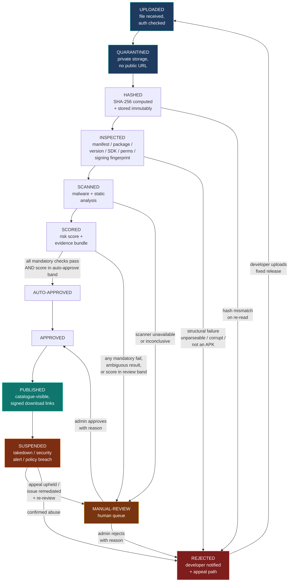
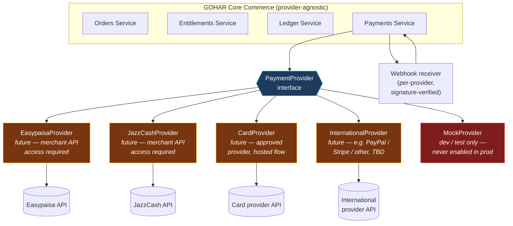
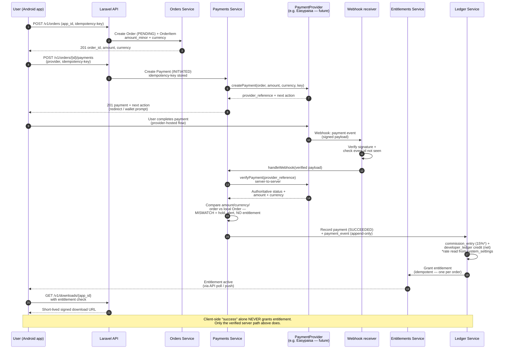
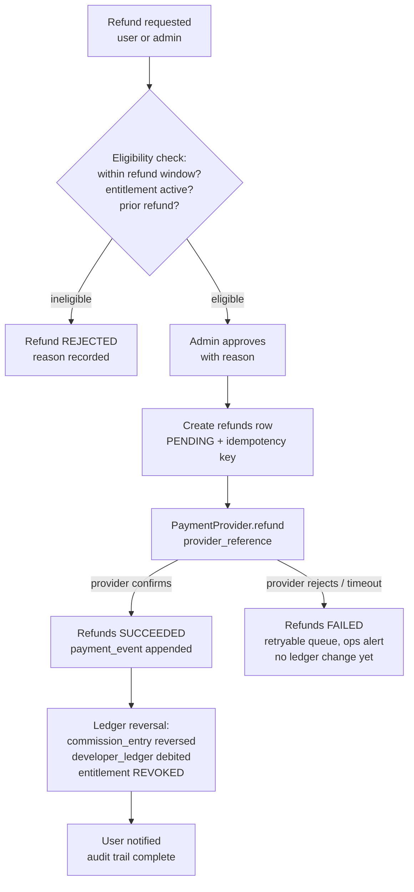
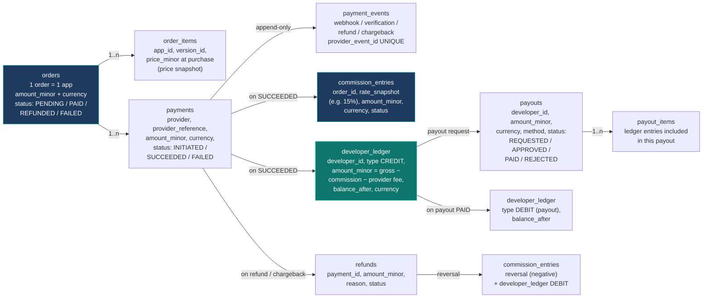
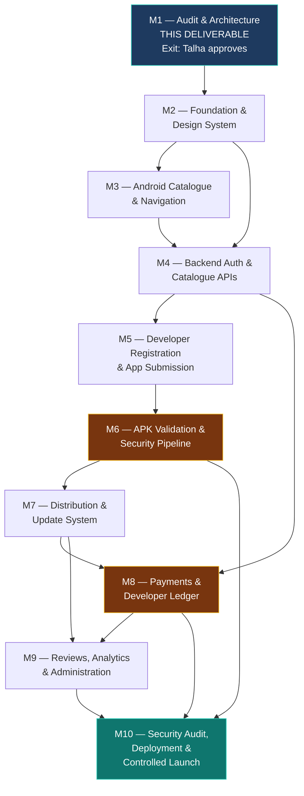

# GOHAR Store — Architecture v1

## Part 3: APK Security Pipeline, Payments & Ledger, Milestones, Risk Register

| Field | Value |
|---|---|
| Document | `03-pipelines-milestones-risks.md` |
| Version | Architecture v1 |
| Date | 26 November 2026 |
| Status | **Draft — for Talha's approval (Milestone M1)** |
| Scope in this file | Sections **F, G, H, J** of the First Deliverable |
| Companion files | `01-audit-architecture.md` (A, B), `02-data-api-screens.md` (C, D, E) |
| Brand | GOHAR Store — *"Where Great Apps Belong"* |
| Commission | **15% proposed, configurable in `system_settings` — never hardcoded** |
| Standing constraint | **Zero-spend** — see §J, risk R-16, and the spend flags throughout |

> **Reading notes**
>
> - **Confirmed choice** = decided in this architecture and to be implemented as stated unless Talha changes it.
> - **Option to evaluate in M6** = a candidate to test during Milestone 6 (APK validation and security pipeline); do **not** treat it as a commitment until evaluated.
> - **Future / out of scope for v1** = named for completeness, not built in v1.
> - No test has been run for this document. No test results are claimed anywhere in it. Any test named in an exit criterion must actually be executed at that milestone and its real result recorded.
> - No payment provider, scanner vendor, API key, secret, or merchant account is claimed to exist. Providers named are integration targets only, subject to merchant API access, approval, and payment testing.

---

# F. APK Security Pipeline Design

## F.1 Principles (confirmed)

1. **Quarantine first.** An uploaded APK is never public, never downloadable, and never linked from the catalogue until it reaches `APPROVED` and is published. Unapproved APKs live only in private object storage.
2. **Never execute untrusted code on the production server.** No APK, DEX, native library, or extracted asset is executed on the Laravel host, the database host, or any host that holds secrets or signing keys.
3. **Unknown or ambiguous is not safe.** A scan that errors, times out, returns an inconclusive verdict, or cannot be verified routes to `MANUAL-REVIEW`. It is never treated as a pass.
4. **Automatic approval requires ALL mandatory checks to pass.** One mandatory failure = no auto-approval. There is no "mostly clean" auto-approval.
5. **Evidence, not just a verdict.** Every signal that contributes to the risk score is stored with its source, value, and timestamp (`validation_results`, `security_scans`, `risk_assessments`). A human reviewer must be able to reconstruct why a release was approved, held, or rejected.
6. **Preserve the developer's signing identity.** GOHAR never re-signs a third-party APK with a shared GOHAR APK signing key. The developer's original APK and its SHA-256 are preserved immutably.
7. **Repository metadata signing is separate.** Repository/index metadata is signed with a dedicated GOHAR-controlled repository key. That key never signs APKs, and no APK signing key ever signs repository metadata.
8. **No malware scan guarantees safety.** Scanning reduces risk; it does not prove an app is safe. The store UI and policies must say so plainly.

## F.2 State machine

States live on `submissions` (one row per uploaded release attempt) and are mirrored in summary form on `app_versions`. Every transition is written to `moderation_logs` and `audit_logs` with actor (system, worker, or admin), timestamp, from-state, to-state, and reason.



### F.2.1 State definitions

| State | Meaning | Who / what moves it onward | Publicly visible? |
|---|---|---|---|
| `UPLOADED` | File received; upload authorisation already checked; not yet quarantined-confirmed | Pipeline worker confirms storage write | No |
| `QUARANTINED` | File in private quarantine storage only; no signed URL issued | Hash worker | No |
| `HASHED` | SHA-256 computed and stored; file re-read verified against it | Inspection worker | No |
| `INSPECTED` | Manifest, package, versions, SDKs, permissions, signing fingerprint extracted and checked for ownership / progression | Scan worker | No |
| `SCANNED` | Malware + static analysis complete (or explicitly inconclusive) | Scoring worker | No |
| `SCORED` | Risk score + evidence bundle recorded; routing decision made | Router (automated rule) | No |
| `AUTO-APPROVED` | All mandatory checks passed and score in auto-approve band; awaiting final publish step | Publish job | No (until published) |
| `MANUAL-REVIEW` | Held for a human: mandatory fail, ambiguous result, or review-band score | Admin reviewer | No |
| `APPROVED` | Human or auto path approved; release cleared for publication | Publish job | No (until published) |
| `PUBLISHED` | Live in catalogue; downloads served via short-lived signed links | Monitoring / admin | **Yes** |
| `REJECTED` | Not publishable in this form; developer gets reasons + appeal path | Developer (new upload) | No |
| `SUSPENDED` | Previously published, now withdrawn (security, policy, takedown, or signing anomaly on a later version) | Admin / re-review | No — removed from catalogue immediately |

**Confirmed rule:** `REJECTED` and `SUSPENDED` are terminal for that `app_versions` row. A fix is a **new** submission with a higher `version_code`, never an in-place overwrite of the rejected file. This preserves the audit trail and prevents unauthorised replacement after approval.

## F.3 Per-step specification

Timeouts and resource limits below are **starting values for M6 evaluation**, not tuned production constants. M6 must measure real APKs against them and adjust with evidence.

| Step | Input | Tool / technique | Output artefacts (stored) | Failure mode → routing | Timeout / resource limit | Isolation |
|---|---|---|---|---|---|---|
| **1. Upload authorisation** | Authenticated developer session/token; `app_id`; file stream | Laravel: Sanctum auth, role `developer`, ownership check (`apps.developer_id` = caller), per-developer rate limit, max file size (confirm in M5; starting value 250 MB), MIME + magic-byte check (`application/vnd.android.package-archive`, ZIP magic `PK\x03\x04`) | `submissions` row (`UPLOADED`), upload metadata, uploader IP/user-agent (audit) | Unauthorised / wrong owner / oversize / wrong magic → reject upload immediately, no file persisted, `audit_logs` entry | HTTP upload timeout per infra (confirm in M10); streaming upload, never whole file in RAM | Laravel app server only; no analysis here |
| **2. Quarantine storage** | Raw upload stream | Private object storage (Cloudflare R2 or equivalent — **spend decision, see §F.7**); server-side encryption; no public bucket policy; randomised object key, never developer-supplied filename; path-traversal-safe key generation | Object key, bucket, size, stored-at timestamp on `submissions` / `app_files` (`storage_location='quarantine'`) | Storage write failure → retryable queue job (max 3, exponential back-off), then `MANUAL-REVIEW` with ops alert; never fall back to local public disk | Queue job timeout 5 min | Storage credentials scoped to quarantine prefix only; app server cannot read production/published prefix with the same credential |
| **3. SHA-256 integrity** | Quarantined object | Streaming SHA-256 (hash while streaming, chunked reads); re-read and compare after write | `app_files.sha256`, `submissions` → `HASHED` | Mismatch on re-read, or hash cannot be computed → `REJECTED` (corrupt upload) + developer notice to re-upload | 10 min for 250 MB at slow storage; streaming, ≤ 64 MB RAM | Hash worker only; no execution |
| **4. Manifest & APK inspection** | Quarantined APK bytes | **Confirmed choice:** `apkanalyzer` (Android SDK) and/or `aapt2 dump` for manifest fields. **Option to evaluate in M6:** `androguard` (Python) for manifest + DEX inspection and permission mapping. Both read-only parsers; neither executes code. | `app_versions` fields: `package_name`, `version_name`, `version_code`, `min_sdk`, `target_sdk`, `app_permissions` rows, icon hash; full parsed manifest stored as JSON in `validation_results` | Unparseable / corrupt ZIP / missing manifest / missing package name → `REJECTED` with structural reason | 2 min; 512 MB RAM; 0.5 vCPU | Disposable container, read-only mount of the APK, no network |
| **5. Package ownership & version progression** | Extracted package name, version code, signing fingerprint; DB history | DB lookups: `apps.package_name` uniqueness; `app_versions` history for this app; `app_files.signing_fingerprint` history | Ownership verdict, progression verdict in `validation_results` | Package already owned by another developer → `MANUAL-REVIEW` (possible squatting — see §F.5); `version_code` not greater than last approved → `REJECTED`; signing fingerprint differs from last approved → `MANUAL-REVIEW`, never auto-approve (see §F.5) | DB query < 5 s | Laravel / DB only; no APK execution |
| **6. Signing verification** | APK bytes + extracted certificate(s) | **Confirmed choice:** `apksigner verify --verbose --print-certs` (Android SDK build-tools). Checks v1/v2/v3 signature scheme validity and certificate chain. **Option to evaluate in M6:** `androguard` certificate parsing as a cross-check, not as the sole verifier. | Certificate fingerprint(s) (SHA-256), scheme versions present, expiry, subject/issuer, `validation_results` entry | Unsigned APK, invalid signature, expired certificate, or `apksigner` error → `REJECTED` (mandatory fail); v1-only signing on `target_sdk ≥ 30` → `MANUAL-REVIEW` (weak scheme) | 2 min; 512 MB RAM | Disposable container, no network |
| **7. Malware scan** | Quarantined APK bytes | **Confirmed choice (v1):** ClamAV (`clamdscan` / `clamscan`) with up-to-date signatures, run in the isolated worker. **Option to evaluate in M6:** a second-opinion / commercial scanner (e.g. a reputable multi-engine API or a second local engine) — **spend + data-sharing decision; do not send APKs to any third party without Talha's approval and a data-processing check**. No scanner is named as contracted. | `security_scans` row per engine: engine name/version, signature DB version/date, verdict, matched signature names (if any), scan duration | Any engine positive → `MANUAL-REVIEW` at minimum; high-confidence malware signature → `REJECTED` after human confirmation (never auto-reject on a single engine alone without review — false positives exist). Engine error / timeout / stale signatures (> 48 h) → `MANUAL-REVIEW` (inconclusive ≠ safe) | 5 min per engine; 1 GB RAM; 1 vCPU | Disposable container, **no network** (except ClamAV signature update, which happens on the worker image build / a separate update job, never during a scan of an untrusted file) |
| **8. Static analysis** | APK bytes, manifest, DEX, resources, native libs | **Reference (not a confirmed product choice):** MobSF-style rule sets — i.e. the *categories* of checks MobSF documents (hardcoded secrets, insecure WebView settings, exported components, cleartext traffic, weak crypto, dangerous permissions, native code, trackers). **Confirmed approach for v1:** implement the highest-value subset as explicit, auditable rules in the Python worker (see §F.4 rubric); **option to evaluate in M6:** run MobSF itself (open-source, AGPL-3.0 — licence obligations to check before bundling/distributing) as an additional analyser, or adopt its rule list without adopting the tool. | Per-rule findings in `validation_results` / `security_scans`: rule id, severity, evidence (file/offset/matched string — redacted where it would leak a secret), `risk_assessments` inputs | Rule engine crash / incomplete DEX parse → `MANUAL-REVIEW` (inconclusive ≠ safe). Findings are signals for scoring, not automatic rejection, except the mandatory-fail list (§F.4.3) | 5 min; 1 GB RAM; 1 vCPU | Disposable container, no network, read-only APK mount |
| **9. Risk scoring** | All artefacts from steps 3–8 | Deterministic scoring function (Python worker, versioned — `risk_assessments.scorer_version` recorded so scores stay comparable and re-scorable) | `risk_assessments` row: total score 0–100, per-signal contributions, band, routing decision, scorer version | Scorer error → `MANUAL-REVIEW` | < 30 s | Scoring worker (no APK access needed — scores from stored artefacts only) |
| **10. Routing / publish** | Score + mandatory-check results | Automated router (Laravel queue job): auto-approve only if §F.4.4 holds; otherwise enqueue in Filament review queue | `submissions` state transition; `moderation_logs` entry; developer notification | Publish job failure → retryable; published file must be re-verified (SHA-256 + fingerprint) before the catalogue row flips to `PUBLISHED` | Publish < 2 min | Publish job copies quarantined object to the published prefix (copy, never move-and-lose-original) and issues CDN-signed URLs only after verification |

## F.4 Risk scoring rubric (0–100)

Higher = riskier. The score is an **operational triage aid**, not a safety certificate.

### F.4.1 Bands (confirmed)

| Band | Score | Routing | Meaning |
|---|---|---|---|
| **Low** | 0–29 | Auto-approve **only if** every mandatory check passes (§F.4.4) | No material signals; routine release |
| **Medium** | 30–59 | `MANUAL-REVIEW` | One or more signals worth a human look; reviewer may approve with a recorded reason |
| **High** | 60–100 | `MANUAL-REVIEW` (priority) | Multiple / severe signals; reviewer should default to reject unless evidence clearly explains them |
| — | Any mandatory fail | `MANUAL-REVIEW` or `REJECTED` regardless of score | Score never overrides a mandatory fail (see §F.4.3) |

### F.4.2 Example signals and weights

Weights are **starting values for M6 calibration**. M6 must score a corpus of known-benign and known-suspicious APKs, measure false-positive / false-negative rates, and adjust weights with the results recorded — not by gut feel. No weight is final until that calibration is documented.

| # | Signal | Weight | Evidence stored | Notes |
|---|---|---|---|---|
| S1 | Known malware signature match (ClamAV / 2nd engine) | +60 | Engine, signature name, DB version | Single high-confidence match can push a release straight to High; never auto-approve |
| S2 | Signing certificate differs from last approved release for this package | +50 | Old + new fingerprint (SHA-256), first-seen date | Mandatory manual review; see §F.5 |
| S3 | Package name already claimed by another developer | +50 | Existing `app_id`, claimant, dates | Possible squatting / impersonation; see §F.5 |
| S4 | `version_code` not greater than last approved | +40 (and mandatory fail, §F.4.3) | Last approved vs submitted code | Blocks progression; reject, don't just score |
| S5 | Requests SMS / call-log / contacts / location / accessibility / device-admin / overlay permissions without a matching declared feature | +10 each, cap +30 | Permission list + manifest feature declarations | Dangerous-permission combination matters more than any single permission |
| S6 | Exported component (activity/service/receiver/provider) without permission protection, or exported provider | +15 | Component name, `exported=true`, protection level | Classic data-exposure / intent-hijack vector |
| S7 | Cleartext HTTP (`usesCleartextTraffic=true` or network-security-config allows cleartext) | +10 | Manifest / config excerpt | Downgrade risk, especially with sensitive data |
| S8 | Hardcoded secret / API key / private key material found in DEX or resources | +20 | Rule id + redacted excerpt (never store the full secret) | Store a hash/prefix only, for matching — never the secret itself |
| S9 | Weak crypto (ECB, hard-coded IV, MD5/SHA-1 for security use, insecure Random) | +10 | Rule id + location | Context matters; reviewer judges exploitability |
| S10 | WebView with `setJavaScriptEnabled(true)` + `addJavascriptInterface` on an exported / untrusted-content WebView, or `setAllowFileAccess` with remote content | +15 | Class/method + setting | XSS / bridge-abuse vector |
| S11 | Native libraries (`.so`) present, especially packed / obfuscated / uncommon arch | +5 | Library list + hashes | Not suspicious alone; raises the value of dynamic analysis (v1: limited — §F.6) |
| S12 | Heavy obfuscation / packer indicators (DexProtector-style, Bangcle-style, or equivalent) | +10 | Detector + indicators | Legitimate apps obfuscate; this is a *review* signal, not a fail |
| S13 | `target_sdk` far below current (e.g. ≥ 3 API levels behind the current target requirement) or `min_sdk` very low with dangerous permissions | +10 | `min_sdk` / `target_sdk` values | Old targets bypass newer platform protections |
| S14 | v1-only APK signing (no v2/v3) | +15 | Schemes present from `apksigner verify` | Tamper-evidence is weaker; see step 6 |
| S15 | Known tracker SDKs / aggressive ad SDKs (list maintained in `system_settings` / M6 config, not hardcoded in the scorer) | +5 | SDK names + versions | Transparency signal; surfaces in the app-details privacy section |
| S16 | First submission from a new / unverified developer | +10 | Developer verification status, account age | Decays after N approved releases (value set in M6; e.g. after 3 clean approvals) |
| S17 | Rapid re-submission after rejection with minimal changes (same DEX hash, version bump only) | +10 | Prior `submission_id`, DEX hash comparison | Possible review-evasion pattern |
| S18 | Icon / name / description closely matches an existing popular app but package/developer differ | +15 | Similarity evidence (name, icon perceptual hash, description overlap) | Impersonation check; human judgement required — automated similarity is a flag, not a verdict |

**Scoring rules (confirmed):** scores are capped at 100; each signal contributes at most once per release unless explicitly noted; the scorer version is stored; a re-score after a rule change creates a new `risk_assessments` row, never silently rewrites the old one.

### F.4.3 Mandatory-fail list (any one blocks auto-approval)

| # | Mandatory check | Fail → |
|---|---|---|
| M1 | SHA-256 cannot be computed or does not match on re-read | `REJECTED` (corrupt upload) |
| M2 | APK unparseable, missing manifest, or missing package name | `REJECTED` |
| M3 | APK unsigned, or signature invalid per `apksigner verify` | `REJECTED` |
| M4 | `version_code` not greater than last approved release | `REJECTED` |
| M5 | Package name owned by a different developer (unresolved) | `MANUAL-REVIEW` (do not auto-reject — ownership disputes need a human) |
| M6 | Signing fingerprint differs from last approved release (unexplained) | `MANUAL-REVIEW` (never auto-approve) |
| M7 | Any malware engine returns an error, timeout, or stale signatures | `MANUAL-REVIEW` (inconclusive ≠ safe) |
| M8 | Static-analysis engine crashes or cannot parse DEX | `MANUAL-REVIEW` |
| M9 | Developer account suspended, or app currently suspended for security | `MANUAL-REVIEW` (admin only) |

### F.4.4 Auto-approval conditions (all must hold)

1. Every mandatory check passes.
2. Risk score is in the Low band (0–29).
3. Developer identity verification status is not `unverified` for a **paid** app's first release (free apps from unverified developers may auto-approve only if score is Low *and* no S2/S3/S5–S10 signal fired — confirm the exact rule in M5/M6 with Talha; see Decisions §D-4).
4. No open security alert or prior suspension on this app.
5. Scorer version and scan-engine versions are current (not stale per §F.3 step 7).

If any condition fails, the release goes to `MANUAL-REVIEW`. Auto-approval is the exception path for clean, routine releases — not the default.

## F.5 Signing-change policy and package-impersonation checks

### F.5.1 Signing-change policy (confirmed)

| Situation | Action |
|---|---|
| First release for a package: fingerprint recorded as the baseline | Store in `app_files.signing_fingerprint` + `app_versions`; baseline is immutable for that package |
| Later release, fingerprint **matches** baseline | Pass (M6) |
| Later release, fingerprint **differs** | **Block auto-approval. Route to `MANUAL-REVIEW`.** Notify the developer and require a written explanation + evidence (e.g. key rotation with proof of control of the old key, or a documented key-loss recovery). Admin may approve only with a recorded reason; approval updates the baseline and logs the rotation in `audit_logs` + `moderation_logs` |
| Fingerprint differs **and** the developer cannot evidence control of the old key | Reject. Treat as potential account takeover / package hijack until proven otherwise |
| Certificate expired, or `apksigner verify` fails | `REJECTED` (M3) |
| Developer requests a legitimate key rotation | Separate admin workflow (not a silent re-upload): developer submits a rotation request, admin verifies identity out-of-band, rotation is logged, and the *next* release is expected to carry the new fingerprint — a release carrying an unannounced new fingerprint is still held |

**Android consequence to surface to reviewers:** if the signing certificate changes, existing users **cannot update in place** — Android will refuse to install the update over the old package. A signing change is therefore also a user-harm event, not just a security flag. The review UI must show this warning.

### F.5.2 Package-impersonation / squatting checks

Performed at inspection time (step 5) and re-checked at publish time:

1. **Exact package collision:** `apps.package_name` is globally unique. A second developer claiming the same package → `MANUAL-REVIEW`, both parties notified, first-claimant evidence reviewed (prior approved release, Play listing, source repo, trademark).
2. **Confusable package names:** edit-distance / token similarity against existing packages (e.g. `com.gohar.store` vs `com.gohar.storee`, or a well-known app's package with one segment changed). Flagged as signal S18; human judgement required.
3. **Brand / name / icon similarity:** app name, icon (perceptual hash), and description similarity against the catalogue and a maintained list of well-known apps. Flagged, never auto-rejected on similarity alone.
4. **Developer-identity mismatch:** app claims to be from / affiliated with a known brand but the developer profile, verification documents, and contact domain do not support it → `MANUAL-REVIEW`, request evidence.
5. **Reserved packages:** GOHAR's own packages and obvious system packages (`com.android.*`, `com.google.android.*` where the developer is not Google) are block-listed in `system_settings`; claiming one → `REJECTED` with an explanation.

## F.6 Dynamic analysis — what is practical vs out of scope for v1

| Approach | v1 verdict | Reasoning |
|---|---|---|
| Emulator sandbox: install the APK in a disposable Android emulator (or equivalent), launch main activities, stimulate UI minimally, capture network calls, file writes, permission requests, and spawned processes | **Limited pilot in M6; not a release gate in v1** | Useful signal, but slow, flaky, and easy to evade (emulator detection, delayed payloads, server-gated behaviour). A "clean" dynamic run proves very little. Use it to *raise* risk on observed bad behaviour, never to *lower* risk to auto-approve. |
| Network-traffic capture in the sandbox (DNS, TLS SNI, cleartext endpoints) | **Pilot in M6** (same caveats as above) | Cheap, high-value signal when it fires (e.g. exfiltration endpoints, cleartext credentials). Requires a controlled MITM-free capture — do not break TLS; record destinations only |
| Automated UI fuzzing / Monkey-style stimulation | **Out of scope for v1** | Low signal per minute, high maintenance; revisit post-launch if a specific abuse pattern justifies it |
| Human interactive dynamic testing | **Manual-review tool only** | A reviewer may install a held APK on an isolated test device/emulator; this is a review aid, never a production-server activity |
| Running the APK on the production server, CI runner, or any host with secrets / network access to production | **Never — explicitly out of scope** | Violates principle F.1(2); any proposal to do this must be rejected |

**Confirmed v1 position:** dynamic analysis is an *investigative* capability for the manual-review queue, not a pipeline gate. No release is auto-approved because a dynamic run looked clean.

## F.7 Pipeline isolation, resources, and infrastructure notes

| Concern | Design (confirmed) |
|---|---|
| Worker isolation | Each scan/analysis job runs in a **disposable container** (Docker as the v1 baseline). **Options to evaluate in M6:** gVisor (`runsc`) or Firecracker microVMs for stronger isolation if the VPS supports them and the operational cost is acceptable. No persistent filesystem survives a job; the container filesystem is destroyed after the job |
| Network | Scan containers run with **no outbound network** (except the narrow, separately-managed signature-update path described in §F.3 step 7). No inbound ports |
| Resource limits | Per-job caps (starting values in §F.3; tune in M6): CPU 0.5–1 vCPU, RAM 512 MB–1 GB, disk 2 GB scratch, wall-clock timeout per step. Jobs exceeding limits are killed and routed to `MANUAL-REVIEW` (timeout ≠ safe) |
| Secrets | Workers hold **no** secrets: no DB write credentials beyond a least-privilege queue/result channel, no storage keys beyond a scoped, short-lived token for the single object being processed, no signing keys, no payment credentials. Signing keys are never present on a worker host |
| Quarantine vs published separation | Separate storage prefixes (ideally separate buckets / separate credentials). The public/CDN path can only ever serve the published prefix, and only via short-lived signed URLs minted by the backend after authorisation |
| Queueing | Laravel queues (Redis) with retryable jobs, dead-letter handling, and per-job idempotency keys so a retried job cannot double-record a scan or double-publish a release |
| Observability | Every job logs: `submission_id`, step, duration, exit code, resource use, engine versions. Worker failures, timeouts, and inconclusive results raise an ops alert (not just a log line) |
| **Spend flag** | The brief's VPS + R2 + CDN + monitoring stack is **not zero-spend**. R2 has a free tier, but egress, storage growth, and a VPS are recurring costs. M10 must produce a real monthly-cost table before controlled launch. If Talha requires a strict zero-spend v1, the deployment target must be re-decided (see Decisions §D-1 and risk R-16) — the pipeline design above does not change, but *where* it runs does |

## F.8 Post-publication monitoring (confirmed)

Publication is not the end of security review:

- Every new version of a published app goes through the **full** pipeline again. There is no "trusted developer, skip scanning" path in v1.
- Published apps are re-scanned when: a scanner signature/rules update materially changes verdicts (batch re-scan job), a security alert names a package/SDK, or a user/app report is upheld.
- A re-scan that newly flags a published app routes it to `SUSPENDED` pending review — it is removed from the catalogue immediately and existing download links are revoked; already-installed copies cannot be remotely removed and users must be notified via announcement if the risk warrants it.
- Download-anomaly monitoring ( §J, risk R-10 ) feeds back into review: abnormal download spikes, geographic anomalies, or a surge of reports on one app trigger a re-review.

---

# G. Payment & Ledger Design

## G.1 Principles (confirmed)

1. **Provider abstraction first.** The core commerce code never calls Easypaisa, JazzCash, a card provider, or any international provider directly. It calls a `PaymentProvider` interface. Each provider is a separate, individually activatable integration.
2. **No provider is assumed available.** Every provider is **future** until: credentials exist, merchant approval is confirmed, sandbox testing passes, and production payment testing passes. Nothing in v1 ships with a live provider unless Talha approves that provider explicitly.
3. **Never grant an entitlement from a client-side success message.** Entitlement is granted only after the backend verifies the payment with the provider (server-to-server verification and/or a verified webhook). A client callback is a *hint to re-check*, never proof.
4. **Money is integers.** All amounts are stored in **integer minor units** (e.g. paisa for PKR, cents for USD) plus a `currency` column (ISO 4217). No floats for money anywhere. Rounding rules are defined per currency and applied once, at the point of calculation, and recorded.
5. **Immutable financial records.** `payments`, `payment_events`, `commission_entries`, `developer_ledger`, `payouts`, and `refunds` are append-only. Corrections are new reversing entries that reference the original — never an `UPDATE` that rewrites history.
6. **Idempotency everywhere money moves.** Every payment creation, webhook handling, entitlement grant, commission entry, and payout is idempotent: replaying the same request or event produces the same single effect.
7. **Pakistan-first, not Pakistan-hardcoded.** PKR is the first currency and Easypaisa/JazzCash are the first local providers to *evaluate*, but currency, provider, tax/fee, and payout rules are configuration, not code branches keyed to a country.
8. **No card data in GOHAR systems.** Card details are never stored, logged, or passed through GOHAR servers. Card payments go through an approved provider's hosted / tokenised flow (PCI scope stays with the provider). This is a hard constraint unless Talha explicitly authorises a different, PCI-compliant arrangement.

## G.2 Provider abstraction



### G.2.1 The `PaymentProvider` interface (confirmed shape; implement in M8)

Every provider implements the same contract. The core never inspects provider internals.

```php
// Illustrative contract — exact signatures to be finalised in M8.
// Amounts are integer minor units; currency is ISO 4217 (e.g. 'PKR', 'USD').

interface PaymentProvider
{
    /** Unique provider key, e.g. 'easypaisa', 'jazzcash', 'card-stripe'. */
    public function key(): string;

    /** Currencies this provider supports (from config, not hardcoded). */
    public function supportedCurrencies(): array;

    /**
     * Create a payment request with the provider for an existing Order.
     * Must be idempotent on $idempotencyKey: same key => same provider
     * reference, no second charge.
     * Returns a provider reference + the next action for the user
     * (redirect URL / wallet prompt / hosted-checkout URL). Never returns
     * a secret.
     */
    public function createPayment(Order $order, int $amountMinor, string $currency,
        string $idempotencyKey): PaymentCreationResult;

    /**
     * Server-to-server verification of a payment by provider reference.
     * Called before granting any entitlement. Returns the provider's
     * authoritative status + the exact amount + currency as the provider
     * records it. The caller must compare amount/currency/order against
     * the local Order and refuse on any mismatch.
     */
    public function verifyPayment(string $providerReference): PaymentVerificationResult;

    /**
     * Handle a provider webhook/callback payload AFTER the receiver has
     * verified its signature. Must be idempotent on the provider event id:
     * a replayed event is acknowledged but has no second effect.
     * Returns the normalised event (type, provider reference, status).
     */
    public function handleWebhook(array $verifiedPayload): ProviderEvent;

    /**
     * Initiate a refund with the provider. Idempotent on $idempotencyKey.
     * A refund is a new provider transaction referencing the original;
     * it never edits the original payment.
     */
    public function refund(string $providerReference, int $amountMinor,
        string $currency, string $idempotencyKey): RefundResult;
}
```

**Provider activation checklist (confirmed — a provider is not "integrated" until all pass):**

| # | Gate | Evidence |
|---|---|---|
| 1 | Merchant / account approval confirmed | Approval message / merchant ID on file (never a secret in the repo) |
| 2 | Credentials stored in the secret manager, not in code or the DB | Secret-manager reference only |
| 3 | Sandbox end-to-end test: create → verify → webhook → entitlement → refund | Test run recorded with real sandbox responses |
| 4 | Webhook signature verification tested with a forged payload (must reject) | Negative test recorded |
| 5 | Production micro-transaction test (smallest real amount, then refunded) | Receipt + ledger entries reconciled |
| 6 | Provider's fee schedule recorded in `system_settings` (fee model, not hardcoded) | Fee config + worked example |
| 7 | Kill-switch: provider can be disabled in admin without a deploy | Admin toggle tested |

The **MockProvider** exists only for local development and automated tests. It must be **impossible to enable in production** (environment-gated + config-gated + a boot-time assertion that refuses to start if it is enabled outside `local`/`testing`).

## G.3 Purchase sequence



### G.3.1 Sequence rules (confirmed)

1. **Order before payment.** A payment always references an existing `orders` row in `PENDING`. No payment without an order.
2. **Amount is server-decided.** The price comes from `app_versions` / `apps` as stored in the DB, never from a client-supplied amount. The client sends `app_id` only.
3. **Idempotency keys are client-supplied and server-enforced.** `Idempotency-Key` header on order creation and payment creation; the same key + same payload returns the original result; the same key + a different payload is rejected (`409`).
4. **Verification before entitlement.** The webhook handler verifies the signature, deduplicates on provider event id, then calls `verifyPayment()` server-to-server and compares amount/currency/order. Only then does it record `SUCCEEDED` and grant the entitlement — in a single DB transaction where the ledger entries and the entitlement are written together, so a crash cannot leave a paid order without an entitlement (or an entitlement without a payment).
5. **Entitlement grant is idempotent.** A unique constraint on `entitlements (user_id, app_id)` (plus order reference) means a replayed webhook or a retried job cannot create a duplicate entitlement.
6. **Download requires entitlement.** The download endpoint re-checks the entitlement on every request and mints a fresh short-lived signed URL. A purchased app's APK is never served from a permanent public link.

## G.4 Refund and chargeback flows

### G.4.1 Refund (user-requested, admin-approved)



**Confirmed rules:**

- A refund is a **new** provider transaction and a **new** set of ledger entries, never an edit of the original payment.
- Entitlement is revoked when the refund succeeds. The user keeps nothing they were refunded for.
- The developer's ledger is debited by the net amount originally credited (gross minus commission), and the commission entry is reversed. If the developer's balance cannot cover the reversal, the payout balance goes negative and is carried against future earnings — it is never silently absorbed by GOHAR without an admin decision recorded in `audit_logs`.
- The refund window, and which reasons qualify, are **policy configuration** (`system_settings` + published refund policy), not code. The default window is a decision for Talha (see Decisions §D-5).
- Duplicate refunds are prevented by a unique constraint on `refunds (payment_id)` for full refunds, and by idempotency keys for partial refunds.

### G.4.2 Chargeback (provider-initiated, no user request)

| Step | Action |
|---|---|
| 1 | Provider notifies GOHAR (webhook / dashboard / email — channel per provider, recorded) |
| 2 | Admin records the chargeback against the original `payments` row; a `payment_events` row of type `chargeback` is appended |
| 3 | Entitlement is revoked immediately (same as a refund) |
| 4 | Ledger reversal mirrors a refund, plus any provider chargeback fee is recorded as a separate ledger line (fee amount from the provider notice, never invented) |
| 5 | The order, user, and developer are flagged for review if the pattern repeats (velocity checks — see §G.7) |
| 6 | Dispute evidence is gathered from `audit_logs`, `payment_events`, and the entitlement record — all immutable, so the evidence pack is trustworthy |

Chargebacks cannot be "handled" by editing a payment row. The append-only ledger is what makes a dispute defensible.

## G.5 Ledger model

### G.5.1 Tables and flow



### G.5.2 Worked example (illustrative — rates from config, not hardcoded)

> A user buys a paid app priced at **PKR 1,000.00** (100,000 paisa). Commission rate at the time of sale is **15%** (read from `system_settings`). Provider fee is, say, **PKR 25.00** (2,500 paisa) — the real fee comes from the provider's fee schedule, recorded in config; 25.00 here is only an arithmetic example.

| Entry | Amount (minor units, PKR paisa) | Note |
|---|---|---|
| Gross sale (`orders.amount_minor`) | 100,000 | Price snapshot at purchase |
| Provider fee | (2,500) | Paid to the provider; recorded as its own line |
| Commission (15% of gross) | (15,000) | `commission_entries.amount_minor`; rate snapshot stored |
| **Developer credit** (`developer_ledger`) | **82,500** | Gross − commission − provider fee |
| Refund later (full) | Developer debited 82,500; commission reversed 15,000; provider fee is **not** automatically recovered — it depends on the provider's refund terms, recorded per refund | See §G.4.1 |

Whether commission is calculated on gross or on gross-minus-provider-fee is a **configuration decision** (see Decisions §D-5). The example above uses gross; the code must read the basis from config, not assume it.

### G.5.3 Double-entry-style invariants (confirmed — enforced in code + tests)

These are invariants, not aspirations. M8 must ship automated tests that assert each one.

| # | Invariant | Enforcement |
|---|---|---|
| I1 | For every `SUCCEEDED` payment, there is exactly one `commission_entries` row and exactly one net `developer_ledger` CREDIT, in the same DB transaction as the entitlement grant | Transactional service method; test asserts all-or-nothing on failure injection |
| I2 | `developer_ledger.balance_after` on each row equals the previous row's `balance_after` + this row's signed amount, per developer + currency | Computed in the service, never trusted from the client; a reconciliation job replays the ledger and flags any drift |
| I3 | Sum of `commission_entries` (net of reversals) + sum of developer net credits + sum of provider fees = sum of gross `SUCCEEDED` payments (net of refunds) | Daily reconciliation job; any mismatch raises an ops alert and blocks payouts until resolved |
| I4 | A payout's `payout_items` sum equals the `payouts.amount_minor`, and every included ledger entry is marked `payout_id` exactly once | Unique constraint on ledger-entry → payout linkage; test asserts no double-inclusion |
| I5 | No payout may exceed the developer's available balance (credits − debits − pending payouts) at approval time | Balance check inside the approval transaction (row lock); re-checked at payment time |
| I6 | A refund/chargeback never creates a second entitlement, and never leaves a `SUCCEEDED` payment with an active entitlement after a full refund | Entitlement revocation in the same transaction as the refund ledger entries |
| I7 | Every money movement has an immutable audit record (`audit_logs` + the ledger row itself) with actor, timestamp, and reason | Service-layer audit writes; no direct ledger writes outside the Ledger Service |

### G.5.4 Reconciliation checks (scheduled jobs — confirmed)

| Check | Frequency | On failure |
|---|---|---|
| Ledger replay: recompute every developer balance from the append-only ledger and compare to stored `balance_after` | Daily | Alert + block new payouts for the affected developer until resolved |
| Provider settlement: compare provider settlement reports / dashboard totals against `payments` + `payment_events` for the same period | Daily (per active provider) | Alert; unmatched items go to a manual reconciliation queue |
| Payout reconciliation: payouts marked `PAID` vs actual payout-provider confirmation | On each payout + daily sweep | Alert; payout stays `APPROVED` (not `PAID`) until confirmed |
| Orphan check: payments in `SUCCEEDED` without an entitlement, or entitlements without a `SUCCEEDED` payment | Hourly | Alert; auto-heal only if the fix is a single, auditable, idempotent grant — otherwise manual |
| Duplicate check: same provider event id, same idempotency key, or same order paid twice | Continuous (unique constraints) + daily report | Constraint violation is itself the alert; investigate before retrying |

## G.6 Payout eligibility rules (confirmed)

A payout may be **requested** only when all of these hold; an admin **approves** it only after re-checking them inside the approval transaction:

1. Developer identity verification status is `verified` (not merely `pending`).
2. A validated payout account exists (`developer_payout_accounts`, status `verified` — bank / wallet details verified per the provider's process, never stored in plaintext beyond what the payout provider requires).
3. Available balance ≥ the **minimum payout threshold** (config in `system_settings`; starting value to confirm with Talha — e.g. PKR 5,000 — see Decisions §D-5).
4. No unresolved refund, chargeback, or fraud flag on the account.
5. The requested amount ≤ available balance, and the amount is in a supported currency for the chosen payout method.
6. Payouts are processed on a **schedule** (e.g. weekly batch — confirm in M8), not instantly on request, so reconciliation can run first.

Payouts are approved by an admin role with financial authority; the developer who requests cannot approve their own payout (separation of duties — see §J, risk R-06). Every approval/rejection is recorded with actor, time, and reason.

## G.7 Duplicate prevention (confirmed)

| Vector | Prevention |
|---|---|
| Duplicate order (double-tap / retry) | Client `Idempotency-Key` header; unique index on `(user_id, idempotency_key)` for orders; same key + same payload → original order returned |
| Duplicate payment creation | Unique index on `(order_id, idempotency_key)`; provider-side idempotency key passed through to `createPayment()` |
| Duplicate webhook processing | Unique index on `payment_events.provider_event_id` (per provider); handler checks "seen?" before any effect; replayed event → `200 OK` acknowledged, no effect |
| Duplicate entitlement | Unique index on `entitlements (user_id, app_id)`; grant is `INSERT ... ON CONFLICT DO NOTHING` + verify |
| Duplicate commission / ledger entry | Created only inside the single payment-success transaction (I1); reconciliation job (I3) detects any drift |
| Duplicate payout | Unique index on payout request idempotency key; ledger entries linked to a payout exactly once (I4); balance re-checked under row lock at approval and at payment |
| Duplicate refund | Unique index on `refunds (payment_id)` for full refunds; idempotency keys for partial refunds |

## G.8 Currency / FX note

- **First currency: PKR.** The system is designed multi-currency from day one: every money column carries a `currency` column; no table assumes PKR.
- **Minor units everywhere.** `amount_minor` (integer) + `currency` (ISO 4217). Display formatting (e.g. `₨1,000.00` vs `$10.00`) is a presentation concern driven by the currency, not a storage concern.
- **No FX conversion in v1.** A purchase is priced, charged, and settled in a single currency. If an app is priced in PKR and a user pays in another currency, that conversion — if ever offered — happens **inside the payment provider**, and GOHAR records the provider-settled amount and currency as authoritative. GOHAR does not run its own FX rate table in v1.
- **Per-currency ledgers.** Developer balances are per `(developer_id, currency)`. A developer earning in PKR and USD holds two balances; payouts are per currency. Cross-currency netting is out of scope for v1.
- **Regional rules are config, not code.** Tax treatment, refund windows, payout thresholds, and supported providers per country live in `system_settings` / provider config. Adding Urdu language support or a new country does not require a commerce rewrite (see §J, risk R-13).

## G.9 Payment threat notes

| Threat | How the design answers it |
|---|---|
| **Webhook forgery** (attacker posts a fake "payment succeeded") | Every webhook receiver verifies the provider's signature (HMAC / public-key, per provider docs) **before** parsing the payload for effect; unverified payloads are logged and dropped with no state change. Webhook secrets live in the secret manager, never in the repo. Forged-payload rejection is a named M8 test |
| **Webhook replay** (attacker re-sends a genuine past webhook) | Provider event id deduplication (§G.7) + `verifyPayment()` re-check against the provider's current authoritative state. A replayed "succeeded" for an already-processed payment has no second effect |
| **Amount tampering** (client or attacker claims a different amount) | Price is server-decided (§G.3.1 rule 2); the webhook handler compares provider-reported amount/currency/order against the local `orders` row and holds on any mismatch — no entitlement, ops alert |
| **Client-side success spoofing** (modified app reports "paid") | Entitlement requires server verification (§G.1 rule 3). The Android app cannot grant itself an entitlement; the download endpoint re-checks it server-side on every request |
| **Duplicate charging** (retry / double-submit) | Idempotency keys end-to-end (§G.7); provider keys passed through so the provider also deduplicates |
| **Refund fraud** (user buys, downloads, refunds repeatedly) | Refund eligibility + velocity checks (repeat-refund flag on user/developer), entitlement revoked on refund, repeat pattern → manual review / account flag. Refund policy published and enforced in code from config |
| **Provider account / key compromise** | Least-privilege provider credentials (payments-only scope where the provider supports it), secret-manager storage, rotation procedure, per-provider kill-switch in admin, anomaly alerts on volume/amount spikes |
| **Insider refund / payout abuse** | Separation of duties (§G.6), role-based access, immutable audit trail on every financial action, daily reconciliation (I3) that would surface an unauthorised reversal |

---

# H. Development Milestones with Dependencies

## H.1 Overview

- **Milestones M1–M10 are kept exactly as specified in the brief. They are not renumbered.**
- Each milestone is independently testable and ends with: files created/modified, functionality implemented, **tests actually executed with real results**, incomplete work, known risks, exact run commands, updated docs, and a commit where repository access permits.
- **No milestone is marked complete because it compiles.** A feature is complete when its named tests have run and passed, and the exit criteria below are met.
- Effort estimates are **honest solo-developer ranges** (one person, part of the existing workload — farm, Sett, Nigaarish, and other tracks continue). They assume the developer is Talha working solo, without a team, and without paid help. Ranges include testing and documentation time, not just coding.

> **Headline: this is a multi-month solo build, not a weekend project.** On the ranges below, M1–M10 total roughly **7–11 months** of sustained solo work (see §H.3). That estimate should be re-baselined after M2, once the foundation is real and velocity is measurable. Do not compress it by cutting the security pipeline (M6), the payment verification (M8), or the security audit (M10) — those are the milestones that decide whether the store is trustworthy.

## H.2 Milestone table

| # | Milestone | Goal | Dependencies | Key deliverables | Exit criteria (tests that must actually run) | Solo effort |
|---|---|---|---|---|---|---|
| **M1** | **Repository audit & architecture** | Establish the truth about the starting point and the design everyone builds to | None (brief + this deliverable) | This First Deliverable: (A) audit — *no existing repo; clean-project design*, (B) system architecture, (C) DB diagram, (D) Android screen map, (E) API spec, (F) pipeline design, (G) payment & ledger design, (H) milestones, (I) infra & deployment plan, (J) risk register | **Talha approves the architecture in writing** (or requests named changes). No code exit test — the deliverable *is* the exit artefact. Decisions §D-1–§D-8 answered or explicitly deferred with dates | **Done in this deliverable** (architecture only) |
| **M2** | **Project foundation & design system** | Reproducible repos, CI, and a real Material 3 design system — no screens built on ad-hoc styling | M1 approved | Android repo (Kotlin/Compose/Material 3, MVVM + Clean Architecture, Retrofit, Room, WorkManager, Hilt/manual DI — justify the choice in the repo README); Laravel repo (Sanctum, PostgreSQL, Redis, queues, Filament skeleton); Docker Compose dev stack; CI (lint + unit-test gates); design-system module (colours — navy/teal, typography, spacing, light/dark themes, accessible contrast ≥ 4.5:1 for body text); `system_settings` table + commission config (15% default, admin-editable) | `./gradlew testDebugUnitTest` passes; `php artisan test` (skeleton) passes; CI green on a clean checkout; design-system screenshot / Compose preview review passes contrast check; `docker compose up` brings the full dev stack up from a clean clone with one command | **3–4 weeks** |
| **M3** | **Android catalogue & navigation** | A usable, navigable storefront over real (seeded) API data — no fake catalogue presented as real | M2 | Onboarding (brand, language selection — English first, Urdu-ready structure, privacy info); Home (featured/trending/new/recommended/categories/recently updated); Search (name/developer, filters, sort, suggestions, empty/error states); Categories (11 launch categories, extensible); App details (full field set from the brief §6); Library + Favourites (local Room persistence); Settings (account/language/theme/notifications/download prefs/privacy/terms/support) | Android instrumented + unit tests: navigation graph test, search test (incl. empty + error states), app-details rendering test, favourites persistence test — all run on at least 2 API levels; manual check on a small-screen and a large-screen device/emulator; no screen ships with hardcoded fake apps outside a clearly-marked dev seed | **4–6 weeks** |
| **M4** | **Backend authentication & catalogue APIs** | Real auth and a real catalogue API the Android app consumes | M2; M3 (contract agreed — build against the OpenAPI spec from `02-data-api-screens.md` §E) | Versioned REST API (`/v1/`): auth (register/login/logout, email verification, Sanctum tokens), user profile, catalogue, search, categories, app details, favourites, reviews (read path); request validation, consistent error responses, pagination, rate limiting, authorisation, OpenAPI spec kept in sync; seeders for categories + demo apps (marked as seed data) | `php artisan test` — auth tests (register/login/verification/token revocation), authorisation tests (IDOR attempts must fail), validation tests, pagination tests, rate-limit tests — all passing with real output recorded; API tested against the Android app from M3 end-to-end (not just curl) | **4–5 weeks** |
| **M5** | **Developer registration & app submission** | Developers can register, verify, and submit APKs — but nothing reaches the public catalogue without approval | M4 | Developer portal (responsive web, Laravel-backed): registration/login, email verification, developer profiles, identity-verification workflow, payout-account management (collect only; verification in M8), app creation, metadata editor, icon/screenshot upload, APK upload → private quarantine, release management, version history, submission status + validation reports visible to the developer | Backend tests: developer registration + verification flow, APK upload auth (wrong-owner upload must fail), quarantine enforcement (unapproved APK has no public URL — test attempts to fetch it directly), metadata validation tests; portal manual test: full submit flow by a test developer account | **4–5 weeks** |
| **M6** | **APK validation & security pipeline** | The pipeline in §F runs for real on real APKs, with evidence, scoring, and human review | M5 (uploads exist to scan); M2 (worker infra) | Python worker service (Docker, disposable containers, no network during scans, CPU/RAM/time caps); manifest inspection (`apkanalyzer`/`aapt2`, androguard evaluated); `apksigner verify`; SHA-256; ClamAV (signatures current); static-analysis rule subset (§F.4); risk scorer (versioned) + calibration report; Filament review queue (approve/reject with reason, signing-change warning, evidence view); auto-approve path gated on §F.4.4 | Pipeline tests on a corpus: ≥ 20 benign APKs (must route correctly, incl. at least one auto-approval and at least one manual-review for a legitimate-but-flagged case) + ≥ 5 known-suspicious / test-malware samples in the isolated lab (must be held/rejected — **never on prod**); mandatory-fail tests (unsigned, corrupt, wrong version_code, changed fingerprint); timeout test (oversized/slow job killed and routed to review, not passed); scorer calibration report published in the repo | **5–7 weeks** |
| **M7** | **Distribution & update system** | Approved apps download securely and update safely, preserving package identity and signing | M6 (approved releases exist); M4 (catalogue) | Short-lived signed download URLs (CDN), download authorisation + entitlement check, DownloadManager/WorkManager downloads (progress, pause/resume, retry, cancel, history), SHA-256 verification on device before install handoff, PackageInstaller handoff (user consent, no silent install), update detection (version-aware, signing-fingerprint comparison before offering an update), release history + changelog | Android tests: download + verify (hash mismatch must block install), pause/resume/retry, update detection (newer version offered; same version not offered; signing-mismatch update **blocked** with a clear message); backend tests: unauthenticated/unauthorised download must fail, expired signed URL must fail, revoked (suspended) app download must fail | **3–4 weeks** |
| **M8** | **Payments & developer ledger** | Paid purchases verified server-side, entitlements correct, ledgers reconcile, payouts controlled | M7 (entitlement-gated downloads); M4 (orders groundwork) | `PaymentProvider` interface + MockProvider (dev/test only, prod-blocked); **first real provider only if its §G.2.1 activation checklist passes** — otherwise the milestone ships with the abstraction + MockProvider and the provider slot documented as pending; orders → payments → payment_events → commission_entries → developer_ledger → payouts/payout_items (all per §G); idempotent webhooks (signature-verified); refunds + chargeback handling; payout request/approval flow; reconciliation jobs (§G.5.4) | Backend tests: purchase flow (mock provider) incl. webhook → verify → entitlement; **negative tests that must pass**: forged webhook rejected, replayed webhook has no second effect, amount-tampered webhook held, client-only "success" grants nothing, duplicate payment/entitlement/payout attempts produce one effect; ledger invariant tests (I1–I7); reconciliation job test with a deliberately broken ledger (must alert); provider activation checklist completed for any live provider, or explicitly deferred in writing | **5–7 weeks** |
| **M9** | **Reviews, analytics & administration** | Trust signals and the admin console work, and every sensitive action is audited | M4–M8 (data exists to review/analyse) | Reviews + ratings (verified-purchase indicator, reporting, developer responses, moderation); developer analytics (sales/downloads/ratings) + earnings/commission/refund statements; admin console (Filament): dashboard, users, developers + verification, catalogue, submission queue, security alerts, scan results, approvals/suspensions/takedowns, review moderation, payments/refunds/commission/payouts, categories, featured/banners/announcements, config, RBAC, audit logs | Tests: review submission + reporting + moderation, verified-purchase flag correctness, analytics totals reconciling to the ledger, RBAC tests (each admin role can only do what it is permitted; privilege-escalation attempts fail), audit-log tests (every sensitive action recorded with actor/time/action/target/reason) | **4–6 weeks** |
| **M10** | **Security audit, deployment & controlled launch** | The store is provably ready — or the launch is honestly deferred | M1–M9 (all prior exit criteria met) | Threat-model review against §J; dependency vulnerability scan + remediation; penetration-style checks (malicious upload, IDOR, webhook forgery, privilege escalation — §17 of the brief); VPS + Docker + Cloudflare + R2 + CDN production deployment; automated backups (tested restore, not just a backup job); monitoring + error reporting + alerts (API, workers, storage, payments, abnormal downloads); CI/CD; published policies (privacy, developer agreement, content policy, refund policy, takedown procedure); controlled-launch plan (invite-only / limited catalogue) | **Full test suite green** (backend + Android + security checklist) with results recorded; **backup restore actually performed** on a staging host; **launch-readiness review against §19 Definition of Done** — every item checked off with evidence or explicitly marked not-ready with a date; go/no-go decision by Talha | **4–6 weeks** |

## H.3 Total effort and sequencing

| | |
|---|---|
| **Sum of M2–M10 ranges** | **36–53 weeks** (≈ 8–12 months) of solo work at the pace implied by the ranges |
| **Plus M1 (this deliverable)** | Architecture only — no build time |
| **Realistic calendar time** | **7–11 months** if worked steadily; longer if other tracks (farm, Sett, Nigaarish) take priority in any given month. The ranges already assume a solo developer, not a team |
| **Critical path** | M1 → M2 → M4 → M5 → M6 → M7 → M8 → M9 → M10. M3 (Android catalogue) can overlap M4 once the API contract is frozen; M9 analytics can start once M8 ledger data exists |
| **What must not be compressed** | M6 (security pipeline), M8 (payment verification + ledger invariants), M10 (audit + backup restore + Definition-of-Done review). Cutting these is how a store ships that looks finished and is not trustworthy |
| **Re-baseline point** | End of M2: re-estimate M3–M10 from measured velocity. The numbers above are planning ranges, not commitments |

## H.4 Dependency graph



**Reading the graph:** the spine is M1 → M2 → M4 → M5 → M6 → M7 → M8 → M9 → M10. M3 branches off M2 and rejoins at M4 (the Android app needs the API contract, and the API needs the app as a real consumer). M8 depends on both M4 (orders/auth) and M7 (entitlement-gated downloads) — a payment that cannot gate a download is not a purchase. M10 depends on everything, and on M6/M8 in particular: the audit is meaningless if the pipeline and the ledger have not been built to be audited.

## H.5 Milestone discipline (confirmed)

1. **Definition of done per milestone** = the exit criteria in §H.2, evidenced by test output, not by a summary claim.
2. **No fake data as real.** Seed/demo data is labelled as such in code and in the UI where a user could see it. Nothing in a milestone report claims a provider, scan, or payment that did not actually run.
3. **Docs updated at each milestone** — the architecture files in `~/workspace/gohar-store/docs/` are living documents; a milestone that changes a decision updates the doc and records the change.
4. **Commit per milestone** where repository access permits, with the milestone number in the message.
5. **Go/no-go at M1, M6, M8, and M10.** Talha explicitly approves the architecture (M1), the calibrated pipeline (M6), the first live provider if any (M8), and the controlled launch (M10). The other milestones report; these four decide.

---

# J. Risk Register

## J.1 How to read this register

- **Likelihood / Impact:** Low / Medium / High, judged for a solo-operated store at controlled-launch scale (not at Play-Store scale). Re-score at M10.
- **Owner:** the person accountable. "Talha" means a decision or action only he can take (account, approval, spend). "Engineering" means the build/agent work. "Shared" means both.
- **Mitigation** = what reduces the chance or the harm. **Contingency** = what happens if it occurs anyway.
- This register is a living document: new risks are added as they are found, and mitigations are checked at each milestone — a mitigation that was never implemented is not a mitigation.

## J.2 Risk register table

| ID | Risk | Category | Likelihood | Impact | Mitigation | Contingency | Owner |
|---|---|---|---|---|---|---|---|
| R-01 | **Malicious APK published** — a harmful app passes the pipeline and reaches users (malware, spyware, fraud, data theft) | Security | Medium | **High** | Full §F pipeline (quarantine, multi-engine scan, static analysis, risk scoring, mandatory-fail list, manual review for anything ambiguous); no "trusted developer" bypass; post-publication re-scan + suspension path; never claim a scan guarantees safety | Immediate suspension + download-link revocation; user notification via announcement; incident log; re-score the pipeline and the scorer calibration; report to affected developers/users honestly | Engineering |
| R-02 | **Signing-key compromise — repository key** — attacker obtains the GOHAR repository metadata signing key and can forge repository metadata | Security | Low | **High** | Separate repository key (never signs APKs); strict access controls; key stored offline / in a secret manager with least-privilege access; documented rotation/recovery procedure; key usage logged | Revoke + rotate the key; re-sign repository metadata; notify users/developers; audit what was signed under the compromised key; publish a transparency note | Talha + Engineering |
| R-03 | **Signing-key compromise — developer key handling** — GOHAR is blamed for, or mishandles, a developer's signing key (e.g. a developer uploads a key, or a support flow asks for one) | Security | Low | High | **Never ask for, accept, or store a developer's APK signing key.** The design has no field, upload, or support flow for private keys. Fingerprints only. Policy stated in the developer agreement | If a key is ever sent to support by mistake: delete it immediately, confirm deletion to the developer in writing, log the incident, and rotate any exposed material | Engineering |
| R-04 | **Payment fraud** — stolen cards/wallets, fake payments, refund abuse, or a user buying, downloading, and refunding repeatedly | Financial | Medium | High | Server-side verification only (§G.1 rule 3); amount/currency/order comparison on every webhook; idempotency; refund eligibility + velocity checks; entitlement revoked on refund; provider fraud tools where offered; daily reconciliation | Freeze the affected account/order; reverse ledger entries per §G.4; provider dispute evidence pack from immutable logs; tighten refund window / velocity thresholds by config (no redeploy) | Engineering |
| R-05 | **Webhook spoofing / replay** — forged or replayed provider webhooks grant entitlements or trigger refunds | Security / Financial | Medium | High | Signature verification before any effect; provider-event-id deduplication; server-to-server `verifyPayment()` re-check; forged-payload and replay tests are named M8 exit criteria | Hold the affected orders (no entitlement); alert ops; rotate webhook secret; audit `payment_events` for any effect the spoof achieved and reverse it | Engineering |
| R-06 | **Insider abuse** — an admin or support account approves a malicious app, issues a fraudulent refund/payout, or reads private data | Security | Low | **High** | RBAC with least privilege; separation of duties (requester cannot approve their own payout/refund); every sensitive action in `audit_logs` with actor/time/action/target/reason; admin accounts protected (strong auth, ideally hardware/2FA — confirm in M9); regular audit-log review | Revoke the account immediately; reverse the unauthorised actions via reversing ledger entries; full audit of that actor's history; disclose to affected parties as the policy requires | Talha |
| R-07 | **Developer impersonation / package squatting** — attacker claims another developer's package, brand, or app identity | Security / Legal | Medium | High | Package uniqueness + ownership checks (§F.5.2); confusable-name and brand/icon similarity flags; identity-verification workflow before paid-app publication; reserved-package block-list | Hold the submission; notify both parties; require evidence of ownership; reject + suspend the impersonating account on confirmation; takedown if already published | Engineering |
| R-08 | **PII / payment-data leak** — user or developer personal data, or payment data, is exposed (breach, misconfig, logging mistake) | Security / Legal | Low | **High** | No card data stored (§G.1 rule 8); secrets in the secret manager, never in code/logs; least-privilege DB/storage credentials; input validation + output encoding; PII minimised in logs; backups encrypted | Breach procedure: contain, assess, notify affected users and (where required) regulators, rotate credentials, fix the root cause, and record the incident — the procedure itself is written in M10, not improvised | Talha + Engineering |
| R-09 | **R2 / CDN misconfiguration exposes private APKs** — a quarantine or unpublished APK becomes publicly downloadable via a bucket policy, CDN rule, or signed-URL mistake | Security | Medium | **High** | Private buckets by default; separate quarantine vs published prefixes/credentials; CDN serves only the published prefix and only via backend-minted short-lived signed URLs; misconfiguration tests in M7 (direct fetch of a quarantined object must fail; expired URL must fail) | Revoke the affected URLs/keys immediately; audit access logs for downloads of the exposed object; notify affected developers; fix the policy and add a regression test that would have caught it | Engineering |
| R-10 | **Abnormal download / abuse patterns** — bot downloads inflate an app's popularity, drain CDN budget, or distribute a suspended app | Technical / Financial | Medium | Medium | Download authorisation + entitlement checks; rate limiting; anomaly monitoring (spikes, geography, user-agent patterns) with alerts; CDN cost alerts; popularity metrics computed from *verified* downloads, not raw hits | Throttle/ block the abusive pattern; exclude bot traffic from rankings; suspend the app if the pattern indicates abuse of the store itself | Engineering |
| R-11 | **Dependency vulnerability** — a library in the Android app, Laravel backend, or Python worker has a known exploitable vulnerability | Security / Technical | Medium | Medium | Dependency scanning in CI (Android + PHP + Python); pinned versions; regular update cadence; vulnerability alerts triaged, not ignored; minimal dependency footprint in the worker image | Patch or pin to a safe version; if no patch exists, disable the affected feature or isolate it until one exists; record the decision | Engineering |
| R-12 | **VPS outage / backup failure** — the single VPS fails, or backups exist but cannot be restored | Ops | Medium | High | Dockerised deployment (rebuildable); automated backups (DB + object storage + config) with a **tested restore** as an M10 exit criterion — a backup that has never been restored is assumed broken; monitoring + alerts for API, workers, storage, and payments; status/announcement path for users | Restore from backup on a fresh host per the M10 runbook; if the restore fails, the runbook — not improvisation — decides the next step; post-incident review | Engineering |
| R-13 | **Easypaisa / JazzCash merchant-access denial** — merchant API access is refused, delayed, or withdrawn, or the terms do not fit a marketplace model | Financial / Product | Medium | High | Provider abstraction (§G.2) means a denied provider is a *configuration* gap, not an architecture failure; the store launches with free apps + the payment abstraction ready, and adds providers as they are approved; international providers evaluated in parallel, not serially after a denial | Launch paid apps on whichever provider clears its activation checklist first; if no local provider clears, paid sales wait and the store operates as a free catalogue + developer platform until one does — this is stated honestly at launch, not hidden | Talha |
| R-14 | **Play Store policy / competition** — Google policy, device defaults, or user habit make a third-party store hard to adopt; or a policy change restricts sideloading / unknown-source installs | Product / Legal | Medium | Medium | The store's differentiator is explicit: developer-friendly commission (15% vs the incumbents' higher take), international + local payment ambition, and transparent moderation — not a claim to replace the Play Store. Onboarding explains the install flow honestly (user consent, PackageInstaller). No silent install, ever | Double down on the developer value proposition and on categories/regions the incumbents serve poorly; keep the Android install flow compliant with current platform rules and re-check it at every target-SDK bump | Talha |
| R-15 | **Scope creep** — the build grows (more providers, more features, more platforms) until M6/M8/M10 are never reached | Product / Technical | **High** | Medium | Milestones with exit criteria (§H); the "future / out of scope for v1" list in this document is enforced — a feature moves into v1 only by a written Talha decision that names what it displaces; go/no-go gates at M1, M6, M8, M10 | Cut back to the milestone's exit criteria; defer the added scope to a named post-v1 list with dates, rather than letting it silently extend the current milestone | Talha |
| R-16 | **Zero-spend vs paid-infrastructure conflict** — the brief's VPS, R2, CDN, monitoring, and commercial scanners need recurring spend that conflicts with Talha's standing zero-spend constraint | Financial / Ops | **High** | High | **Flagged explicitly in this document wherever spend arises** (§F.7, §G.2.1, §H). M10 must produce a real monthly-cost table *before* launch. Free tiers (R2 free tier, Oracle Always Free as evaluated for SHIRAZI, etc.) are evaluated as *options*, not assumed to cover production load | Talha decides: (a) approve a named monthly budget, (b) accept a reduced-scope free-tier deployment with named limits, or (c) defer controlled launch until a budget exists. The architecture does not change; the *deployment target* does. No paid service is provisioned without that decision | **Talha** |
| R-17 | **F-Droid licence / architecture mismatch** — adopting F-Droid code or tooling without checking its licences (AGPL-3.0/GPL-3.0), its re-signing model, or its FOSS-only scope creates licence obligations or breaks the "preserve developer signing" rule | Legal / Technical | Low | Medium | F-Droid is treated as a **reference only** in v1 (§F.3 step 8, and `01-audit-architecture.md` §B). No F-Droid code is bundled, no fdroidserver component is adopted, and no repository is built on its model, until a licence + architecture review is done and Talha approves it | If F-Droid tooling is ever adopted, the review documents: licence obligations, source-distribution duties, signing-architecture fit, and what must change in §F. Until then, the pipeline in §F is the system of record | Engineering |
| R-18 | **Solo-developer capacity / key-person risk** — one person holds the architecture, the keys, the provider relationships, and the launch decision; illness, farm work, or another track pauses the build | Ops / Product | Medium | Medium | Docs are the continuity plan: this deliverable + per-milestone docs + runbooks (M10) must let a second person rebuild and operate the store; secrets and keys are documented (locations and recovery, never values) in a form Talha controls | Pause at a milestone boundary (never mid-migration); the milestone report states exactly what is done, what is not, and what the next step is, so work resumes without re-discovery | Talha |

## J.3 Threat model summary

### J.3.1 Actors

| Actor | Goal | Capabilities assumed |
|---|---|---|
| **Malicious developer** | Publish a harmful app, impersonate another app/developer, or abuse payouts/refunds | Can create accounts, upload arbitrary APKs, write any metadata, attempt to evade scans (obfuscation, delayed payloads, emulator detection) |
| **Compromised account** (user or developer) | Use a stolen session/credential to publish, purchase, refund, or change payout details | Has valid credentials for one account; does not initially have admin access |
| **Malicious APK** (as an artefact, not a person) | Harm users or the store after install | Arbitrary code on a user's device; may attempt to exfiltrate data, show fraud, or escalate — the pipeline must assume this about *every* APK until evidence says otherwise |
| **Payment fraudster** | Obtain paid apps without paying, or extract money via fake payments / refund abuse | Can modify the Android client, replay/forage webhooks, use stolen payment instruments, automate refund requests |
| **Insider** (admin / support / anyone with privileged access) | Approve a bad app, issue a fraudulent payout/refund, or read private data | Has legitimate privileged access; abuse is misuse of that access, not an external break-in |
| **Opportunistic attacker** (external) | Exploit a web/API flaw: IDOR, injection, broken auth, misconfigured storage | Internet access, standard tooling, knowledge of common vulnerability classes; no insider access initially |
| **Infrastructure / supply-chain attacker** | Compromise a dependency, the VPS, the CDN, or a scanner to affect many apps at once | Varies; assumed capable of exploiting an unpatched dependency or a leaked credential if one exists |

### J.3.2 STRIDE-style table

| Threat class | Example against GOHAR Store | Design answer (where in this document) |
|---|---|---|
| **Spoofing** | Attacker poses as another developer, or forges a payment webhook, or spoofs a popular app's identity | Identity verification (M5); package ownership + similarity checks (§F.5.2); webhook signature verification (§G.9); Sanctum auth + RBAC (M4/M9) |
| **Tampering** | Attacker modifies an APK after approval, tampers with a payment amount, or edits a ledger row | Immutable SHA-256 + fingerprint on approval (§F.3, §F.5); no in-place replacement after approval; server-decided prices + amount comparison (§G.3.1); append-only ledger (§G.5.3, I1–I7) |
| **Repudiation** | Admin denies approving a bad app; developer denies a payout request; user denies a purchase | `audit_logs` + `moderation_logs` on every sensitive action with actor/time/action/target/reason (M9, §J.2 R-06); immutable `payment_events` (§G.5) |
| **Information disclosure** | Private quarantine APKs, user PII, payout account details, or secrets leak | Private storage + signed URLs only (§F.7, §J.2 R-09); no card data (§G.1 rule 8); secrets in the secret manager; least-privilege credentials |
| **Denial of service** | Download floods, API abuse, or a malicious APK that hangs the scan worker | Rate limiting (M4); per-job CPU/RAM/time caps with kill-and-review (§F.7); queue back-pressure; CDN + monitoring (M10) |
| **Elevation of privilege** | A developer reaches admin functions; a user reads another user's orders/entitlements; a reviewer approves their own payout | RBAC + authorisation tests incl. IDOR (M4, M9); separation of duties (§G.6); privilege-escalation negative tests are M9 exit criteria |

### J.3.3 What this threat model does *not* claim

- It does not claim the store is safe from a threat because a mitigation is *named*. A mitigation counts only when it is implemented and its named test has run (M6/M8/M9/M10 exit criteria).
- It does not cover physical device security of users' phones, or the security of the payment providers' own systems — those are the providers' responsibility, and GOHAR's duty is to choose providers carefully, verify server-side, and never expand its own PCI scope.
- It is re-reviewed at M10 against the as-built system. If the build diverged from this document, the threat model is updated to match the build — not the other way round.

---

# Decisions Needed from Talha Before M2

M2 (project foundation) should not start until these are answered or explicitly deferred with a date. Each decision names what it unblocks.

1. **Architecture approval (M1 exit).** Approve this Architecture v1 as the basis for M2, or list the named changes required. *Unblocks: everything.*
2. **Spend decision — infrastructure budget.** The brief's VPS + R2 + CDN + monitoring stack is not zero-spend. Choose one: **(a)** approve a named monthly budget (amount + what it covers); **(b)** approve a reduced-scope free-tier deployment with named limits, accepting that scale and some features will be constrained; or **(c)** defer the deployment decision to M10 and run M2–M9 on local/dev infrastructure only. *Unblocks: M2 infrastructure choices, M10 deployment plan. See risk R-16.*
3. **Repository location and visibility.** Confirm the GitHub organisation/account and whether the Android, Laravel, and worker repos are public or private from day one, and who has access. *Unblocks: M2 repo creation and CI.*
4. **First-release auto-approval rule for unverified developers.** §F.4.4 condition 3 proposes: a paid app's first release from an unverified developer never auto-approves; a free app's first release may auto-approve only if the score is Low and no S2/S3/S5–S10 signal fired. Confirm, tighten (no auto-approval at all until verified), or loosen. *Unblocks: M5/M6 implementation of the router.*
5. **Money configuration (defaults for `system_settings`).** Confirm or change: **(a)** commission 15% on gross (vs gross-minus-provider-fee); **(b)** minimum payout threshold (starting suggestion: PKR 5,000); **(c)** refund window (starting suggestion: 14 days from purchase for a defective / not-as-described app — confirm the qualifying reasons); **(d)** payout schedule (starting suggestion: weekly batch). These are config values, so they can change later — but M8 needs starting values to implement and test against. *Unblocks: M8 ledger + payout implementation.*
6. **Payment provider order.** Confirm the evaluation order for the first live provider: Easypaisa first, JazzCash first, a card provider first, or an international provider first — and whether Talha will pursue merchant API access himself or wants the application/requirements documented for him to submit. No provider work starts until its §G.2.1 activation checklist is the governing process. *Unblocks: M8 provider work. See risk R-13.*
7. **Second-opinion malware scanner.** Approve or decline sending APKs to a second-opinion / commercial scanner in M6 (data-sharing + spend implications), or direct that v1 ships with ClamAV alone and the second opinion is a post-v1 decision. *Unblocks: M6 scanner selection and §F.3 step 7.*
8. **Dynamic analysis pilot.** Approve a limited emulator-sandbox pilot in M6 (investigative only, never a release gate — §F.6), or defer it to post-v1 and keep M6 to static analysis + scanning only. *Unblocks: M6 worker scope.*
9. **Controlled-launch shape (early signal, not a final commitment).** Indicate the intended launch shape so M2–M9 can aim at it: invite-only with a handful of developers, a small public catalogue of free apps first, or paid apps from day one. This can change before M10, but an early signal prevents building the wrong launch. *Unblocks: M9/M10 planning; informs M8 provider urgency.*

---

*End of Part 3 (Sections F, G, H, J) — GOHAR Store Architecture v1, 26 November 2026.*
*Companion files: `01-audit-architecture.md` (A, B) · `02-data-api-screens.md` (C, D, E).*
*Next step after Talha's approval: Milestone M2 — project foundation and design system.*
